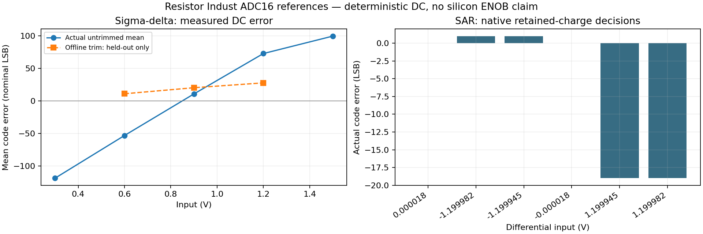
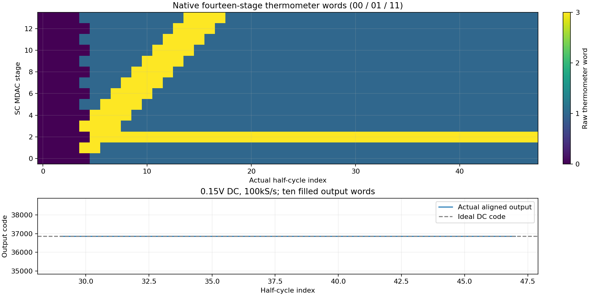

# Resistor Indust · 16-bit ADC 작업대

SAR, 2차 시그마델타, 파이프라인 세 구조를 실제 MOS/R/C 계층 회로와 디지털 RTL로 추가했습니다. **16-bit 출력 인터페이스를 가진 연구용 레퍼런스**입니다. 실물 16-bit ENOB, 전체 입력 코드의 INL/DNL, 잡음·편차·지터·제조 signoff를 달성했다는 의미는 아닙니다.

## 앱에서 사용하기

1. 최신 소스로 Resistor Indust와 native/WSL 엔진을 시작합니다. 이전 설치 파일에는 이번 소스 변경이 포함되지 않을 수 있습니다.
2. **설계 도구 → 통합 설계 → 회로 · 연결 탐색 → 회로 template 지원 범위 읽기**를 누릅니다.
3. **16bit ADC · SAR / ΣΔ / Pipeline**을 펼치고 구조를 선택합니다.
4. `전체 … ADC 생성` 또는 `…개 계층 블록 준비`를 선택합니다. 기존 프로젝트 읽기는 해석을 다시 실행하지 않습니다.
5. 회로도에서 ANALOG/CONTROL/MODULATOR/ALIGN 등 실제 하위 계층을 탐색합니다. **Testbench**에서 조건을 저장한 뒤 **Simulate**로 실행합니다.
6. Simulation의 실제 파형, signed VDD 전류, 노드 전압, 칩 레퍼런스 검사표를 확인합니다. 입력·기준 전원·디지털 재생 전력은 합계 VDD 전력과 다릅니다.
7. 지원되는 하위 블록의 `물리 생성`은 실제 PCell 마스크를 만듭니다. DRC/LVS/PEX는 각각 별도로 실행합니다. 비어 있는 전체 ADC 레이아웃을 PASS로 검사하지 않습니다.


전체 mixed 회로나 디지털 CMOS 계층을 편집한 경우, 기존 RTL을 몰래 대입해 해석하지 않습니다. 다시 합성하고 아날로그/디지털 경계를 명시적으로 연결해야 한다는 오류를 반환합니다. 아날로그 코어·하위 블록의 native 해석은 현재 편집한 회로를 사용합니다.

## 세 구조와 실제 경계

| 구조 | 구현 | 기본 조건 | 실제 검사 범위 |
|---|---|---|---|
| SAR16 | 차동 4+4+4+4 CDAC, 동일 1pF C 244개, bridge 6개, preamp·동적 latch, 16회 제어기 | 입력 ±1.2V, LSB 36.62109375µV, 획득 8µs + 비중첩 0.5µs + 판단 16µs | 한 번의 transient에서 전하 상태를 보존하고 실제 MOS 비교 16회를 RTL/gate/CMOS graph와 대조 |
| ΣΔ16 | 실제 2차 CT RC/MOS 루프, 1-bit DAC, CIC3 R=256, 25-bit 모듈러 연산·포화 | 입력 fixture 0.3…1.5V, 변조 1MHz, 출력 3.90625kS/s, nominal LSB 27.4658203125µV | 실제 latch 비트열을 RTL/gate/CMOS 및 독립 full-precision FIR과 대조; 처음 두 출력 프레임은 RTL이 억제 |
| Pipeline16 | 차동 1.5-bit SC MDAC 14단, 마지막 registered 2-bit flash, 중복 코드 복원·정렬 | 입력 ±1.2V, 기본 100kS/s, 두 비중첩 위상 | 전체 14단 MOS transient, 실제 thermometer word의 14 half-cycle 정렬; 처음 판단부터 전체 지연 15 half cycles |

세 디지털 회로는 Icarus에서 실제 실행하며 Yosys 합성 게이트와 편집 가능한 CMOS 연결 graph의 논리 재생을 함께 비교합니다. 이것은 전체 디지털 MOS 소자의 지연·소비전력·STA 증명이 아닙니다.

SAR 기본 RTL clock은 2MHz입니다. START에서 VALID까지 49 clock 간격=24.5µs이며 다음 START는 한 clock 뒤에 받을 수 있어 최대 START 빈도는 40kS/s입니다. 원본 native 보고서의 `sample_rate_Hz≈40.816k`는 외부 아날로그 sequencer의 프레임 빈도입니다. 전체 RTL의 처리율을 뜻하지 않습니다. 전체 SAR의 획득·hold 시간은 이 RTL clock 수에 맞도록 검사하며 독립 시간 실험은 analog core에서 합니다. ΣΔ CODE의 표시 시각은 nominal falling-edge 디지털 재생 경계이며 실제 디지털 MOS 지연을 측정한 시각이 아닙니다. Pipeline ALIGN의 외부 CLK는 두 위상을 읽는 half-cycle clock(기본 200kHz)이 필요합니다.

## 수학과 단위

SAR의 가장 아래 bank 총합은 32Cu입니다. `Cb = 32Cu/15`이면 다음 bank가 보는 직렬 등가값은 `Cb×32Cu/(Cb+32Cu)=2Cu`, 아래 bank의 감쇠는 1/16입니다. 상위 bank의 실제 30Cu에 이 등가 2Cu가 더해져 각 비트의 차동 DAC 가중치가 `2^i/65536`이 됩니다. 이 등식은 **이상적인 명목 커패시터 비율**이며, MOS 스위치·배선·비교기의 실제 오차는 native 해석으로 별도 측정합니다. SAR의 원리와 고정밀 trimming 필요성은 [Analog Devices의 SAR 설명](https://www.analog.com/en/resources/technical-articles/successive-approximation-registers-sar-and-flash-adcs.html)을 참고했습니다.

CIC3의 전달식은 `H(z)=(1+z⁻¹+…+z⁻²⁵⁵)³`, DC gain은 `256³=2²⁴`, group delay는 입력 382.5 samples입니다. 25-bit 모듈러 적분/comb 연산과 독립 정수 FIR을 비교합니다. filter settling과 실제 ADC 정확도는 다릅니다. [AN-0979](https://www.analog.com/en/resources/app-notes/an-0979.html)는 sinc 필터의 지연·정착을 참고한 자료이며, 해당 상용 ADC의 성능을 재현했다는 주장은 아닙니다.

시그마델타 두 번째 적분기는 저항으로 `V+ = (VCM+2VIN)/3`를 만들어, 명목식 `y₂′=−(y₁−VCM)/τ₂−2(bVDD−VIN)/τ₂`의 입력 feedforward를 구현합니다. 단순 VCM 연결에서 생기던 첫 번째 적분기의 입력 의존 DC 이동을 제거했습니다. 추가 저항 부하를 버티도록 VCM 분압은 실제 100Ω+100Ω을 사용합니다. **약 16.2mW를 소비하는 강한 기준회로**이며 저전력 bandgap/버퍼가 아닙니다. 입력 RC는 100Ω/100pF입니다. 1MHz 변조기의 anti-alias 필터를 대신하지 않으므로 외부 대역 제한이 필요합니다.

파이프라인은 `rᵢ₊₁=2rᵢ−dᵢ`, `dᵢ∈{−1,0,+1}`, nominal thresholds ±1/4을 사용합니다. 14단 후 2-bit flash `q`의 복원식은 `CODE=clip(32766+Σdᵢ·2^(14−i)+q,0,65535)`입니다. 실제 stage thermometer 00/01/11과 flash 000/001/011/111만 허용하며, 잘못된 word는 ERROR를 올리고 VALID를 억제합니다. 구조·중복 보정·증폭기 정확도의 한계는 [Analog Devices의 pipeline 설명](https://www.analog.com/en/resources/technical-articles/understanding-pipelined-adcs.html)을 참고했습니다.

앞서 제공된 [arXiv:2610.15240](https://arxiv.org/abs/2610.15240)은 이전 SAR12 작업의 검증 관점에 사용한 논문입니다. 이번 세 16-bit ADC가 그 논문의 실측 성능을 달성했거나 논문과 동일한 회로라는 주장은 하지 않습니다.

## 실제 실행 결과 · 2026-10-20

실행 원본은 [native index](../examples/adc16-lab/native/index.json), [디지털 QA](../examples/adc16-lab/qa/verification.json), [물리 QA](../examples/adc16-lab/physical/index.json)에 있습니다. 로그·입력 회로·실제 raw/재생 코드의 hash를 보존합니다.

| 검사 | 관측 |
|---|---|
| SAR native directed 입력 | 6개 입력에서 16회 판단·RTL/gate/CMOS 재생 일치, 모호한 비교 0. 최대 코드 오차 **19 LSB → 1 LSB 기준 FAIL** |
| SAR 앱 실행 | 기본 중앙 입력 1개, 실제 worker/GUI 실행, 오차 0 LSB. 범위 전체의 FAIL을 대체하지 않음 |
| Pipeline 전체 MOS | 240µs, 36,802 raw rows, 0.15V DC에서 10개 출력, 최대 1 LSB, malformed/ambiguous 0. 이 DC 조건의 검사 통과 |
| Pipeline 디지털 | 65,536개 nominal 입력 코드 전부 실제 RTL/gate/CMOS 및 독립 복원식 일치; malformed 2건과 VALID 공백 처리 확인 |
| SAR 제어기 디지털 | 524개 directed 코드에서 획득·비중첩·16회 판단·CODE/VALID 재생 일치 |
| CIC3 디지털 | 22,535개 입력 sample, 실제 RTL/gate/CMOS와 독립 FIR 일치. 74개 출력, 리셋·포화·모듈러 wrap 검사 |
| 개별 블록 | 공통/아날로그/디지털 단독 17개 fixture 실행 통과. 각 블록의 기능 허용오차이며 16-bit 정밀도 검사가 아님 |

시그마델타 최신 강한 기준회로의 무보정 DC 평균 오차:

| 입력 | 오차 (16-bit nominal LSB) | ±32 LSB 기능 기준 |
|---|---:|---|
| 0.3V | −119.000 | FAIL |
| 0.6V | −53.333 | FAIL |
| 0.9V | +10.667 | PASS |
| 1.2V | +72.833 | FAIL |
| 1.5V | +99.667 | FAIL |

입력 끝단 두 점으로 gain/offset을 맞춘 **오프라인 평균 코드 분석**의 독립 held-out 세 점 최대 오차는 27.695 LSB입니다. [trim study](../examples/adc16-lab/trim-study.json)에 학습점/검사점·계수·같은 회로 hash를 기록했습니다. RTL에 적용한 보정 기능이 아니며 원래 raw FAIL 판정은 그대로 유지됩니다. 16-bit 정밀도에는 추가 아날로그 보정과 INL/DNL·noise 검사가 필요합니다.




## 물리 배치·DRC/LVS/PEX

| 실제 물리 프로젝트 | 공개 SKY130 검사 |
|---|---|
| SAR16 아날로그 코어 | 972.410×972.360µm, 1,000×1,000µm·edge 10µm 안에 배선 포함. 244개 unit을 16×16 grid에서 동일 명목 중심으로 배치. DRC/LVS/PEX 실행 통과 |
| Pipeline 차동 1.5-bit stage | 실제 PCell 마스크·배선, DRC/LVS/PEX 실행 통과 |
| ΣΔ 두 번째 적분기 | 실제 PCell 마스크·배선, DRC/LVS/PEX 실행 통과 |

초기 SAR 배치는 경계 초과로 차단됐습니다. 실제 net이 한 row에만 있는지 계산해 글로벌 채널을 줄이고, 허용 M4/M5 pitch 안에서 스위치/비교기를 다시 배치했습니다. 소자나 도형을 축소·잘라내지 않았습니다. 기본 SAR12 라우터 설정은 유지했습니다.

PEX의 PASS는 **추출 실행과 기본 무결성**입니다. 이상적 C와 추출 coupling-C의 정합, 전체 RC의 post-layout ADC 정확도, EM/IR, antenna/density, foundry signoff를 증명하지 않습니다. ΣΔ/Pipeline **전체 ADC 마스크와 전체 디지털 배치·배선은 아직 생성/검증되지 않았습니다**. GDS/OAS 프로젝트에는 이 상태를 유지합니다.

## 재현

실제 SKY130 모델, Magic/Netgen, ngspice, Yosys, Icarus 및 KLayout Python이 설치된 native Linux/WSL 환경에서 실행합니다. Docker는 필요하지 않습니다. 모델/도구 설치는 [native runtime 안내](native-runtime.md)를 참고하세요.

```bash
python3 scripts/adc16-synthesize.py
python3 -m unittest discover -s workers/eda -p test_adc16.py
python3 -m unittest discover -s workers/eda -p test_sar12.py
python3 scripts/adc16-digital-qa.py
python3 scripts/adc16-unit-qa.py
python3 scripts/adc16-block-qa.py --label my-block-run
python3 scripts/adc16-native.py --kind sar_adc16 --mode 0 --label my-sar-run
python3 scripts/adc16-native.py --kind sigma_delta16 --input 0.9 --label my-sdm-run
python3 scripts/adc16-native.py --kind pipeline_adc16 --label my-pipeline-run
```

이미 결과가 있는 native label은 덮어쓰지 않습니다. 새 label로 실행하세요. Pipeline 기본 native 해석은 이번 환경에서 약 14분 걸렸습니다. 중단·타임아웃·파형 stop-time 미도달은 미완료로 남기며, 완료 echo만으로 PASS 처리하지 않습니다.

```bash
node scripts/adc16-lab.mjs
node scripts/adc16-lab.mjs --kind=sar16_analog --physical --checks
node scripts/adc16-lab.mjs --kind=pipeline16_stage --physical --checks
node scripts/adc16-lab.mjs --kind=sdm16_integrator --physical --checks
node scripts/adc16-physical-export.mjs
```

위 Node 스크립트는 `.runtime/adc16/lab`의 별도 **Resistor Indust** workspace를 사용합니다. 사용자의 엔진, Edu 프로젝트, 기존 설계를 교체하지 않습니다. import한 프로젝트의 run은 비워 두며 새 revision에서 다시 실행해야 합니다.
