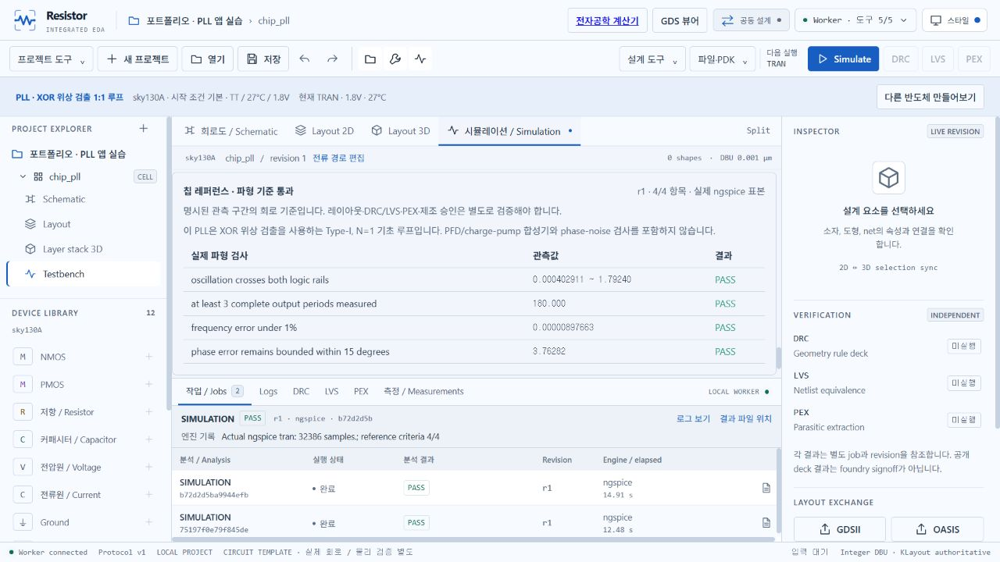
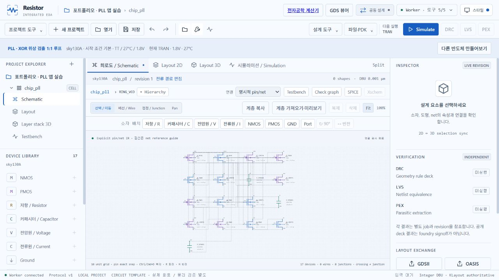

# 칩 레퍼런스 구현·검증 기록

[사용 가이드와 6종 레퍼런스](../examples/chip-portfolio/README.md).

`chip_references.py`가 공개 SKY130 MOS·이상적 R/C의 편집 가능한 계층 IR,
어댑터 소유의 제한된 testbench와 실제 표본 기준을 제공합니다.
기존 `design.catalog/create_template`, `starter.catalog/create`, `simulation.run`,
프로젝트 ZIP 형식을 그대로 사용합니다. 임의 SPICE·쉘 실행 API는 추가하지 않았습니다.

물리 레이아웃은 생성하지 않으며 기존 backend의 NO_PHYSICAL_LAYOUT 검사가
DRC/LVS/PEX·post-layout 실행을 차단합니다. UI는 실제 job의 reference criteria를
표시하고 미완료·이전 revision·해당 기준 미검사를 구분합니다.

이번 점검에서 계층 ZIP의 JSON key 정렬이 block의 named-pin map 순서를 바꾸어
잘못된 PORT_MISMATCH를 만드는 문제를 수정했습니다. 이름 집합과 유일한 child-port
선언을 검사하고 SPICE의 실제 포트 순서는 child declaration을 사용합니다.
순서만 바뀐 JSON은 동일 회로로 복구되며 누락된 핀은 계속 거절합니다.

긴 PLL 해석의 기본 8자리 텍스트 출력에서 서로 다른 두 시각이 같은 값으로
반올림되어 전류·파형 패널의 축 검사에서 거절되는 문제도 발견했습니다.
칩 참조 deck의 `numdgt=17` 설정과 실제 파형·전류 축의 엄격 증가 검사로 수정했습니다.
기존 saved results를 변경하지 않고 새 native job으로 재검사했습니다.

검증:

- 독립 수치·경계·훼손·계층 순서 fixture 12개와 기존 그리기 Python 검사 6개 통과.
- 기존 core 검사 152개, typecheck와 production build 통과.
- 6종 × SS/TT/FF의 native jobs 18개 모두 실행 완료. 파형 기준은 16개 충족,
  PLL SS/FF 2개 미충족으로 기록. TT 6종의 기준은 모두 충족.
- 6개 ZIP 재개방에서 runs=0, shape=0; DRC/LVS/PEX 요청은 18건 모두 거절.
- 모든 공개 파형과 전류 축의 엄격 증가·실제 전류 가지 저장을 확인.
- VCO의 TT 0.8/0.9/1.0V 세 지정 tuning point가 단조 증가함을 실제 해석으로 확인.
- 외부 참조 경로를 바꾼 LDO portable SPICE deck을 별도 폴더에서 실제 재실행.
- 실제 브라우저에서 새 PLL 생성, 해석 실행과 재실행, 기준 4/4 표시,
  단자 전류·전압강하 표시, RING_VCO 계층 열기를 확인.

원본 jobs와 테스트 작업공간은 `.runtime/eda` 및 `.runtime/chip-portfolio`에 보존했습니다.
엔진의 image-owned 파일을 빌드해 연결했고 기존 실행·프로젝트를 지우지 않았습니다.
기존 CPU16 엔진과 중간 엔진 컨테이너는 정지된 backup 이름으로 보존했습니다.
현재 설치 파일을 새로 배포하거나 Mac/Linux 실기기 실행을 검증한 작업은 아닙니다.
