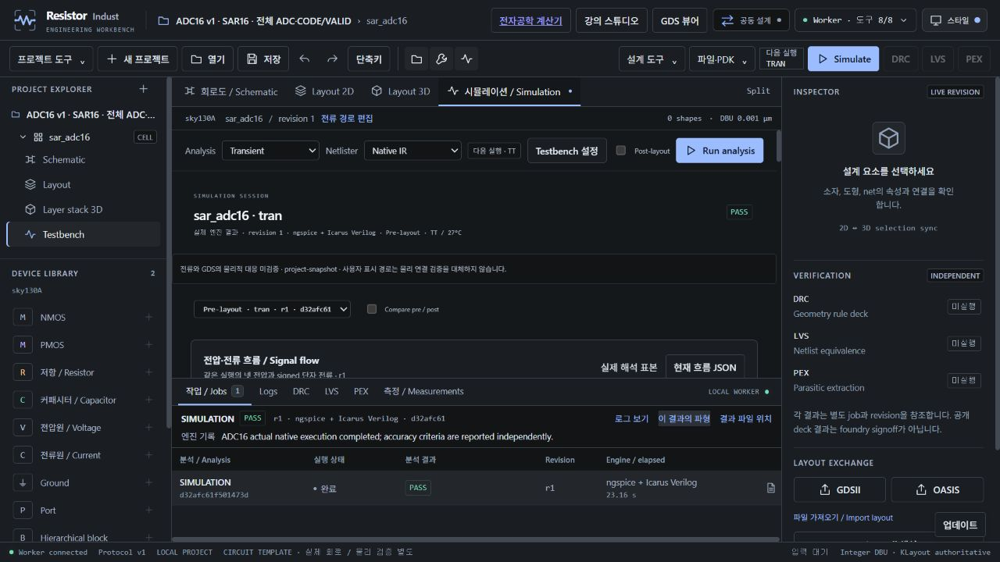

# Resistor Indust debugging and QA — 2026-10-24

This pass covers the shared ADC16 engine, its Indust workbench integration, and the existing core regression suite. It is not a manufacturing qualification or a new installer release.

## Fixed defects

- Mixed ADC and digital replay now compare the complete declared cell set and every cell's ordered ports, devices, parameters and models. Missing cells or changed interfaces cannot silently fall back to the original circuit/RTL. Display coordinates and IDs remain editable.
- Digital ADC16 fixtures reject AC/DC/OP and post-layout requests instead of substituting logical transient replay for the requested analysis.
- Native ADC16 traces must start at zero, contain finite increasing timestamps and complete columns, and reach the requested stop time. SAR now receives the same completeness check as the other ADCs. Empty native output becomes a structured engine error.
- RTL/gate/CMOS agreement also requires the full, ordered output record, bounded 16-bit codes and binary status. Identically truncated outputs, duplicate indices, unknown values and overflow cannot pass.
- Pipeline ambiguity checks follow the actual half-cycle alignment of all fourteen stage words and the final flash. Earlier history and the opposite sampling phase are included when consumed by an output.
- Standalone analog fixtures report `ngspice`; digital fixtures report `Icarus Verilog`. A measurement outside a shortened transient's recorded interval fails instead of being clamped to the last sample.
- The ADC16 library caches each successful creation immediately, blocks overlapping actions and keeps command IDs for retries. Reopening a prepared batch does not create again. Transport/catalog changes invalidate pending follow-up actions; read-only access can open already known projects. Project/scene identity and revision must agree before display.
- Unit QA output defaults to `.runtime`, with an explicit `--out` option. Digital QA also accepts `--out`. Published example evidence is preserved.

## Executed verification

| Check | Result |
| --- | --- |
| Core/frontend regression | 272 passed, zero failures |
| Python TestCase suite in ResistorEDA | 209 run, zero failures/errors; one Windows-only case skipped |
| Skipped Windows path case on Windows Python | 1 passed, so the platform-specific case was exercised |
| New ADC16 negative-control regression | 9 passed within the Python suite |
| Actual RTL/gate/CMOS replay | Pipeline 65,536 nominal codes; 2 malformed-word cases with VALID bubbles; SAR 524 directed codes; CIC 22,535 samples / 74 output words |
| Actual native smoke | Capacitor fixture, SAR16 controller, SAR16 ADC default input completed and passed their declared criteria |
| Actual incomplete-fixture negative control | A 1µs capacitor run failed with missing sampling time; it was not marked PASS |
| Saved Pipeline native trace re-analysis | 36,802 raw rows; 10 output words; identical resampled stage words; zero ambiguous consumed levels |
| Actual UI | 12 SAR/common templates created once each; repeated batch generated zero creation requests; SAR opened and simulated; voltage/current view displayed; console errors: 0 |
| Project bundle | New ID, unchanged schematic and geometry fingerprint, zero imported jobs; malformed ZIP rejected without adding projects; source preserved |
| Typecheck/build | Passed; existing bundle-size and non-module appearance script warnings remain |
| Documentation links | 538 checked, zero missing at the initial check |
| Source/archive audit | Passed; the final audit is retained with this evidence |

The UI-triggered native run is `d32afc61f501473da7659808b6a3b573`: TT / 27°C, pre-layout, one zero-differential input, 0 LSB code error, 23.16s. That one input is not a sweep or a 16-bit ENOB measurement. The retained Pipeline trace was re-analyzed, not re-simulated.

Evidence: [native results](evidence/debug-qa-20261024/native.json), [UI actions](evidence/debug-qa-20261024/ui.json), [UI native result](evidence/debug-qa-20261024/ui-native-run.json), [digital replay](evidence/debug-qa-20261024/digital.json), [Python regression](evidence/debug-qa-20261024/unit-tests.json), [Pipeline trace re-analysis](evidence/debug-qa-20261024/pipeline-trace-reanalysis.json).



## Reproduce

Run from the repository root. The Python examples use the installed ResistorEDA WSL runtime and public SKY130 models; use the corresponding native Python/tools on other supported hosts.

```powershell
npm run test:core
npm run typecheck
npm run build
npm run check:docs
npm run audit:source
wsl -d ResistorEDA -- /home/resistor/.local/share/resistor/engine/bin/python3 scripts/adc16-unit-qa.py --out .runtime/qa-20261024/unit
wsl -d ResistorEDA -- /home/resistor/.local/share/resistor/engine/bin/python3 scripts/adc16-digital-qa.py --out .runtime/qa-20261024/digital
wsl -d ResistorEDA -- /home/resistor/.local/share/resistor/engine/bin/python3 scripts/adc16-trace-qa.py
node scripts/debug-qa.mjs
```

`debug-qa.mjs` uses its own Indust workspace under `.runtime/qa-20261024/workspace`. It creates QA projects and invokes actual tools there. Set `RESISTOR_QA_OUT` to retain another native smoke run separately. The user workspace, Edu workspace and existing jobs are not repurposed.

## Remaining limits

The [ADC16 reference scope](adc16-lab.md) still applies. The prior directed SAR maximum 19 LSB and raw sigma-delta DC maximum 119 LSB have not been optimized away by this debugging pass. Sixteen output bits do not establish sixteen effective bits. Full ADC coupled extraction, noise/mismatch/jitter qualification, full-chip timing, licensed commercial execution and foundry manufacturing signoff remain unestablished. Existing installers/download bundles have not been rebuilt or published by this QA pass.
