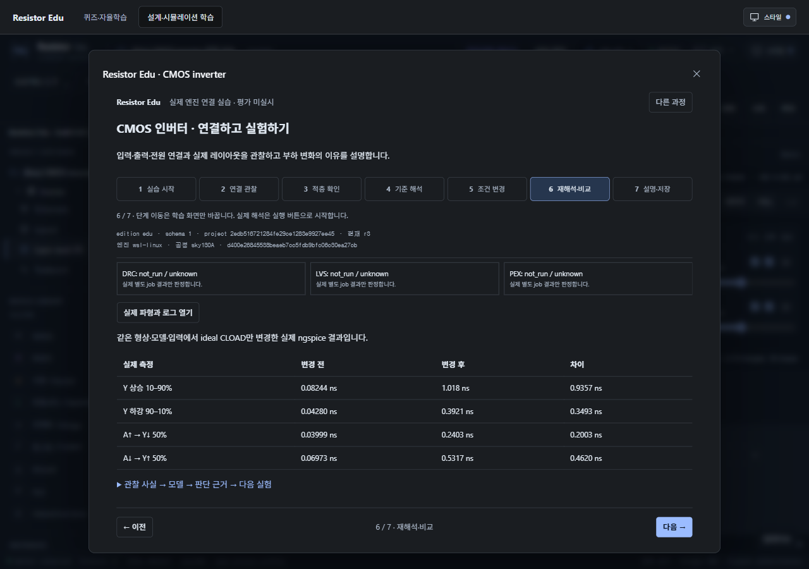
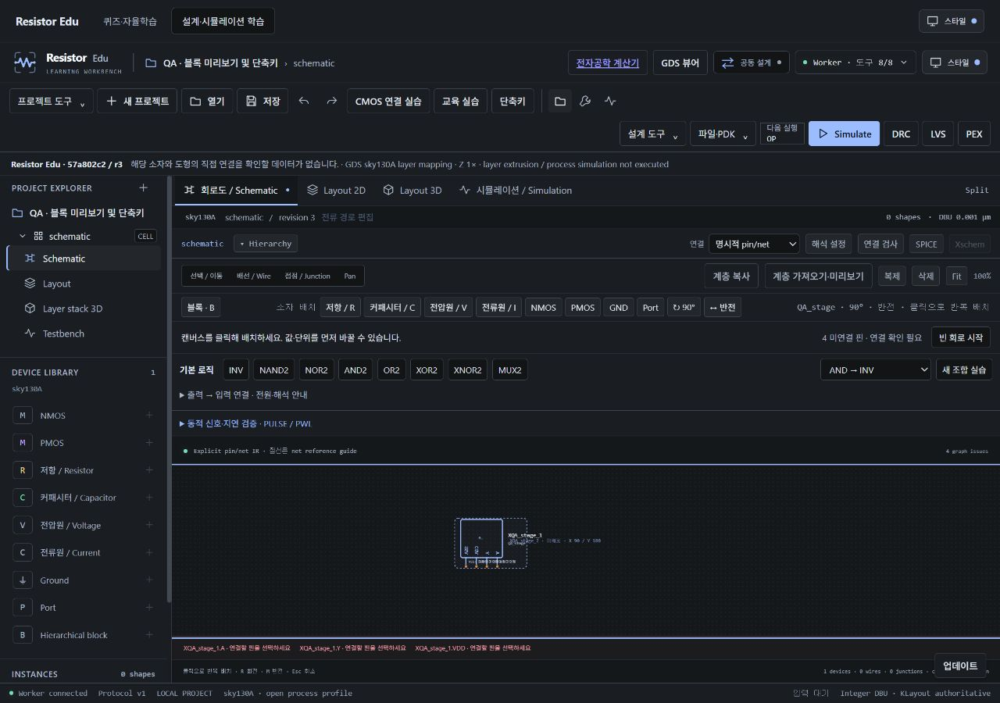
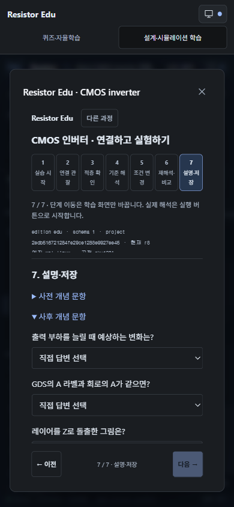

# Resistor Edu · 학습 모드, 단계 페이지와 블록 배치

2026-10-16 · `codex/resistor-edu`. 공통 KLayout·ngspice·회로 명령·단위 계산을 재사용한다. 새로운 공정·P&R 엔진이나 학습용 가짜 파형을 만들지 않는다.

## 시작하기

```sh
npm ci
npm run dev:edu
```

기본 Edu 주소는 `http://127.0.0.1:5177/eda`이며 이번 로컬 QA는 포트 5187을 사용했다. 실제 설계는 [기존 네이티브 엔진 설정](native-runtime.md)을 따른다. 저장 문제·채점·추천은 엔진 없이 실행하고, 실제 퍼즐 시뮬레이션이나 설계 요청에만 엔진이 필요하다. Industry의 데이터·키를 Edu 폴더로 복사하지 않는다.

## 두 가지 학습 모드

- **퀴즈·자율학습**: 저장된 76문제, 회로 퍼즐·대화 코치, 오늘의 리그·커뮤니티. 학생 자율학습과 QA 기록을 구분한다.
- **설계·시뮬레이션 학습**: 회로도, 레이아웃, 표시 적층, 실제 해석, CMOS 연결 실습, 과제·레퍼런스.

모드를 왕복해도 열린 설계·퀴즈 입력을 유지한다. 숨겨진 설계 화면은 전역 설계 단축키를 처리하지 않는다. 모드 선택은 Edu 전용 기기 설정으로 저장하고 공통 밝기·스킨 선택은 유지한다. 새로고침 후 퀴즈 미제출 입력을 복구하는 기능과 구분한다.

## 7단계 설계 실습

1. **실습 시작**: 기존 설계와 별개인 새 인버터 실습 또는 저장 기록을 연다.
2. **연결 관찰**: 소자·핀·net과 회로/레이아웃 대응 근거를 읽는다. 주석 후보를 LVS 성공으로 확정하지 않는다.
3. **적층 확인**: layer mapping, 표시/실제 높이 입력, 배율을 구분해 확인한다.
4. **기준 해석**: 기준 5 fF의 실제 ngspice 실행을 시작하고 도구 오류·실행 상태를 읽는다.
5. **조건 변경**: CLOAD 1~1000 fF 범위에서 하나만 바꾸고 revision 변경을 확인한다.
6. **재해석·비교**: 새 revision의 실제 결과를 실행해 비교한다. DRC/LVS/PEX는 각각의 실행 상태를 표시한다.
7. **설명·저장**: 사전·사후 개념 답과 학생 설명을 저장하고 다시 연다.

이전·다음과 번호 버튼으로 한 단계씩 이동한다. 단계 내용이 길 때만 해당 내용 영역을 스크롤한다. 페이지 이동은 실제 실행·검증 통과·과제 완료를 만들지 않는다. 초안과 페이지 위치는 기록별로 기기에 보관하고 **학생 설명·조건·결과 저장**으로 서버에 확정한다. 다른 창의 저장과 충돌하면 원본을 덮어쓰지 않는다. 재접속 시 짧은 저장 잠금은 읽기만 제한적으로 재시도하며 해석을 자동 실행하지 않는다.



## 난이도와 재사용

| 수준 | 분류 근거 | 예시 |
|---|---|---|
| L1 기초 | 한 공식·기본 단위 | 무부하 분압, τ=RC |
| L2 응용 | 두 계산 연결 | 병렬 부하 → 분압, 분압 → 소비 전력 |
| L3 심화 | 부하·등가회로의 다단계 계산 | 테브난 저항 → 직렬 경로 → RC 시정수 |

자동 추천은 동일 수준의 최근 독립 결과 3개 평균이 80점 이상이면 한 단계 상승, 40점 이하이면 하향한다. 1~3 범위에서 유지한다. 개인 문제 은행은 문제 ID·버전당 첫 독립 객관식/수치 풀이만 사용하며 해설 도움·재시도·QA·AI 서술 평가는 제외한다. 리그는 실제 완료한 일별 시도만 사용한다. 근거와 표본 수를 표시하며 저장 문제를 선택하므로 추가 호출은 없다. 이 분류는 교육학적 보정이나 학습 효과 입증을 뜻하지 않는다.

AI 출제는 기존 승인·상한·캐시를 유지하면서 선택 수준의 설명 요구 또는 허용된 수식 조합을 요청한다. AI가 수치 정답·리그 점수를 만들지 않는다. 출제 요청은 날짜·난이도별로 한 번만 고정한다. [리그 운영과 저장 범위](edu-study-league.md).

## 블록 검색과 배치

회로도 캔버스에서 **B** 또는 **블록 · B**를 누른다. 하위 셀 이름·핀으로 검색해 선택하고, 캔버스에서 원하는 위치에 클릭한다. 10 unit 격자의 실제 좌표와 미배치 미리보기를 표시한다.

- **R**: 배치할 블록 90° 회전.
- **M**: 좌우 반전.
- **클릭 반복**: 같은 셀을 서로 다른 이름으로 계속 배치.
- **Esc**: 배치 취소.
- **Ctrl/Cmd+Z**: 적용된 배치 Undo. 전체 키는 **단축키**에서 검색.

셀의 실제 포트 순서·이름을 유지하고 핀은 미연결 상태로 시작한다. 배선 후 연결 검사를 실행한다. 자기 자신·간접 순환·누락된 하위 셀은 배치 후보에서 차단하며 엔진도 다시 검사한다. Hierarchy의 ＋ 역시 즉시 고정 위치에 넣는 대신 같은 미리보기 흐름을 사용한다. 이 기능은 공통 회로도 UI와 기존 `add_device`/Undo 엔진을 사용하므로 두 에디션 빌드에서 공유된다.



## 확인 결과와 범위

- 실제 브라우저에서 모드 왕복 후 퀴즈 입력 유지, 1~7 페이지 단독 표시, 이전/다음 입력 유지, 저장·재열기와 기록별 페이지 복원을 확인했다.
- 별도 QA 인버터 `2edb516721284fe29ce1283e9927ee45`: 기준 r2 5 fF / 변경 r3 75 fF, 두 ngspice run 각각 1544 samples. 상승 10–90%는 약 0.08244 ns → 1.018 ns. 해당 조건의 실제 실행 관찰이며 제조·전체 PVT·교육 효과 판정이 아니다.
- 같은 QA 프로젝트의 DRC/LVS/PEX는 **not_run / unknown**이다. 시뮬레이션 결과를 다른 검사 성공으로 승계하지 않는다.
- 별도 빈 QA 회로에서 B 검색, R/M, 두 위치 반복 배치, Esc, Undo를 실행했다. 서버 snapshot에서 첫 블록의 `(90,180)`, 회전 90°, mirror true, 네 개 미연결 핀과 Undo 후 한 개 잔존을 확인했다.
- 리그 QA 서버에서 독립 수식 답안 5개가 L3 100점으로 채점됐다. L1 순위에는 그 점수가 없고 시작 후 설정이 잠겼다. QA 결과는 공개 서버에 복사하지 않았다.
- 응용·심화 전체 49,152개 변형은 독립 수식·같은 차원의 단위로 검사하고 기존 반올림과 0.1% 허용 오차를 유지한다.
- 단위/코어·에디션·타입·빌드·소스·문서 검사는 저장된 [검증 보고서](evidence/edu-learning-workflow/verification.json)를 참고한다. 브라우저 QA는 Windows에서 진행했으며 새 macOS 설치 파일을 발행한 것은 아니다.



## 공통 변경의 전달

브랜치 기본 에디션과 명시적 `RESISTOR_EDITION` 체계를 유지한다. 공통 UI·단위·회로 엔진 수정은 `main`/Industry에 해당 변경 커밋을 검토해 cherry-pick 또는 병합하고 두 에디션 빌드와 `test:editions`를 실행한다. 엔진 파일을 복사해 별도로 발전시키지 않는다. 에디션 설정·학생 기록·Industry 프로젝트·자격 증명은 전달 대상이 아니다. 이번 작업은 Edu 브랜치에서 구현·검증하며 Industry 실행 폴더의 사용자 데이터를 수정하지 않았다.
