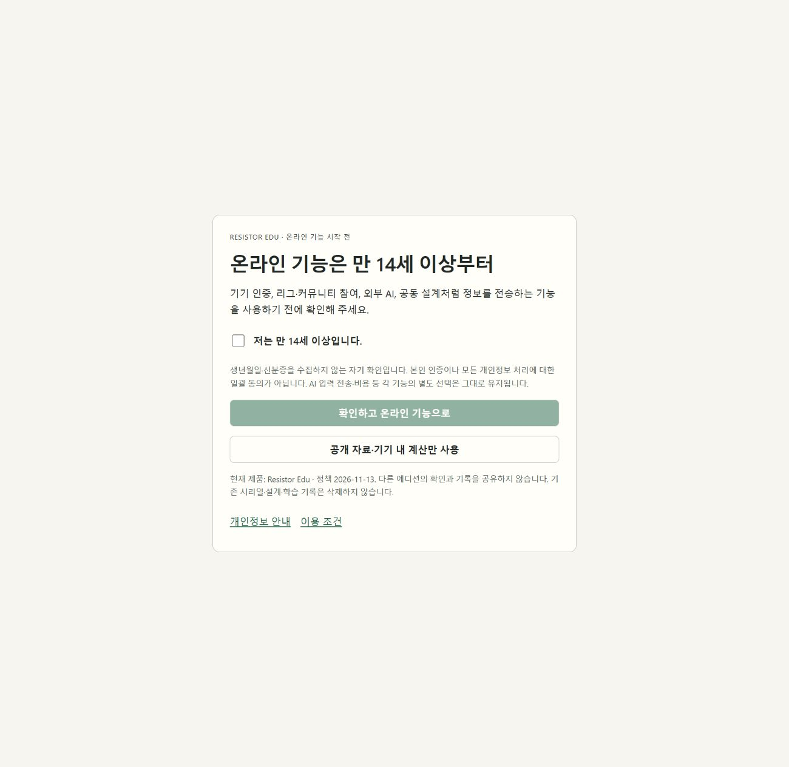
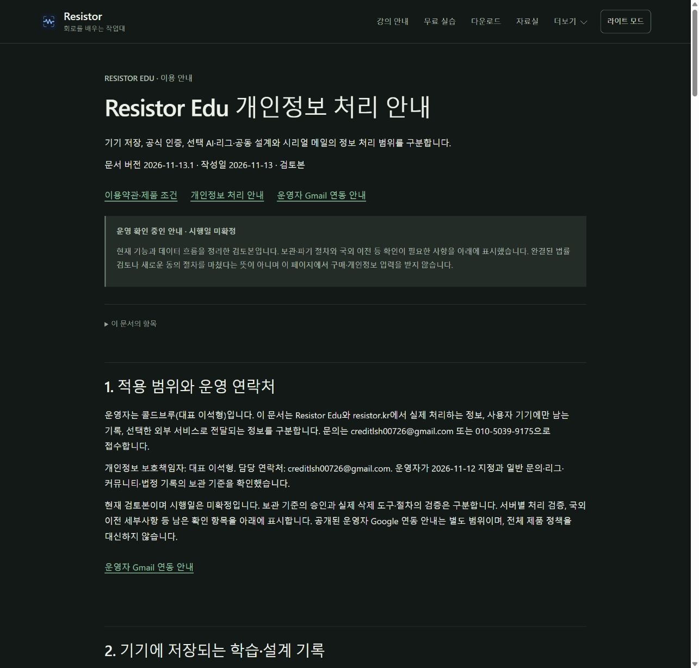

# Resistor Edu 개인정보·서명 후속 작업 — 2026-11-13

## 실제 제공 상태

resistor.kr와 resistor-downloads.vercel.app의 약관·개인정보 안내를 문서 버전 `2026-11-13.1`로 갱신했다. 배포 ID는 `dpl_354vQ6RvZ5Fr87dZ7m8dgd2nbae6`이다. 기존 production `dpl_9YVotLE1xFjsugiKUcv1ouQoES3X`의 297개 파일 중 `terms/index.html`, `privacy/index.html`만 바뀌었고 나머지 295개, API 출력, 라우팅, 다운로드·자동 업데이트 메타데이터는 보존했다. 공개 양쪽 도메인 검사 74/74를 통과했다.

정책은 **검토본**, 시행일은 **미확정**이다. 공급자별 실제 처리 국가·계약·보관 및 운영 삭제 절차가 확정되지 않았으므로 법적 준비 완료로 표시하지 않는다. 이번 정책 페이지 배포가 설치 앱 배포나 새 동의 획득을 뜻하지 않는다.

## Edu 소스 구현

- 만 14세 이상 자기 확인을 edition·정책 버전·확인 시각과 함께 기기에 저장한다. 생년월일·신분증은 수집하지 않는다.
- 확인 전 인증 활성화·갱신, 자동 업데이트 조회, 외부 AI, 리그 등록·조회와 공동 설계 복원·전송을 요청 경계에서 막는다. AI 요청의 개별 전송·비용 승인은 별도로 유지한다.
- 유효한 기존 lease·로컬 프로젝트·학습 기록은 유지한다. 로컬 계산과 사용권 해제를 구분하며, 확인 자체가 라이선스를 대신하지 않는다.
- Industry에는 새 Edu 연령 제한을 강제하지 않는다. 서명 검사와 엔진·계산 로직의 공통 구조를 유지한다.
- 보관 설계는 운영자가 승인한 원문 30일·기술 상세 90일·운영자 백업 30일을 기록하고, 메타데이터만 받는 수동 검토 계획기를 구현했다. 사용권·법정 기록, 미해결·분쟁 및 데이터 관계가 분리되지 않은 대상은 보류한다. 실제 삭제를 수행하는 도구가 아니다.

새 소스는 `codex/edu-privacy-20261113`에 분리했다. 공개 0.33.0 설치 파일과 기존 공개 인증·리그 서버에는 새 연령 제한을 배포하지 않았다. 기존 버전 갱신을 일괄 차단하지 않았다. 새 설치 파일은 별도 버전의 OS별 검증·공개 과정이 필요하며 0.33.0 파일을 같은 이름으로 교체하지 않았다.

## 검증

| 범위 | 결과 |
| --- | --- |
| 최종 `npm run test:core` | 595/595, 실패 0 |
| 사이트 생성·문서 디자인 | 11/11 |
| `npm run typecheck` | 통과 |
| `npm run build` | 통과; 기존 큰 JS 묶음 경고 유지 |
| 실제 브라우저 | 처음에는 확인 버튼 비활성화, 미확인 상태의 로컬 분압기 계산 10 V / 10 kΩ / 10 kΩ → 5 V·0.5 mA, 명시 확인 저장 및 재열기, 시리얼 인증 별도 유지 |
| 모바일 DOM 배치 | 390×844에서 문서 폭 390, 확인 카드 폭 358, 가로 넘침 없음. 마지막 모바일 캡처의 축척이 일치하지 않아 해당 이미지는 시각 증거에서 제외 |
| 공개 배포 | 74/74, 두 도메인과 네이티브 다운로드 메타데이터 보존 |

브라우저 실습은 별도 `.runtime/age-ui-qa`를 사용했다. 실제 학생 프로젝트·시리얼이나 외부 AI를 사용하지 않았다. 합성 네트워크 검사에서는 확인 전 실제 fetch·새 API 비용 예약이 0회임을 확인했다. 테스트를 실제 구매·외부 엔진·서명 검증으로 확대 해석하지 않는다.

## 서명과 제공자 문의

운영자는 Apple Developer 멤버십과 Windows 유료 서명을 모두 보류했다. Apple은 로그인 후 ₩129,000 결제 단계, Azure는 로그인된 현재 테넌트의 구독 0개까지 확인했다. 결제·인증서 발급·공증은 하지 않았다. 공통 preflight가 실제 선택한 인증서·SignTool·Developer ID·notarytool을 확인하도록 강화했으며 자격 정보 없는 상태의 `--require-trusted` 실패가 정상이다. 현재 공개 Windows는 unsigned, Mac은 ad-hoc·미공증 상태다.

운영자가 승인한 초안을 Cloudflare·Google·Vercel·OpenAI 공식 개인정보 연락처로 각각 한 번 발송하고 보낸편지의 수신자·제목·본문을 다시 읽었다. 고객 정보·시리얼·키·첨부는 보내지 않았다. SENT 확인은 받는편지함 도착, 지원팀 답변이나 계정 조건 확정의 증거가 아니다. Resend에는 발송하지 않았다.

## 다음 작업의 조건

1. 제공자 답변을 확인해 실제 국가·보관·계약 근거를 확정하고 정책 시행일을 결정한다.
2. 보관 목적을 분리한 스키마·수동 처리 절차와 복구 후 재삭제 절차를 검증한다. 검토 계획을 실제 파기 완료로 취급하지 않는다.
3. 새 Edu 설치 버전을 네 OS에서 검증·공개한 후 연령 제한의 적용 버전을 고지한다. 서버 강제는 기존 이용자를 보호하는 전환을 별도로 진행한다.
4. 유료 서명 재개 승인 뒤에만 인증서·멤버십을 발급하고 실제 바이너리 서명·타임스탬프·공증·Gatekeeper 결과를 확인한다.

관련 기록: [정책 검토](privacy-completion-20261113.md), [클라이언트 전환](edu-online-access-migration-20261113.md), [보관 결정](privacy-retention-decisions-20261113.md), [문의·발송 증거](privacy-provider-inquiries-20261113.md), [서명 준비](native-trusted-signing.md), [공개 경로 검사](evidence/legal/privacy-publication-20261113/public-verification.json).

