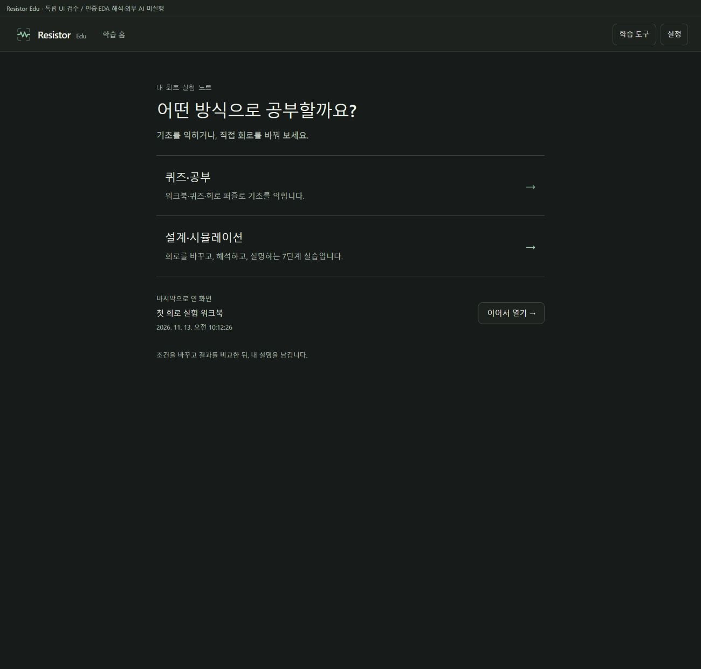
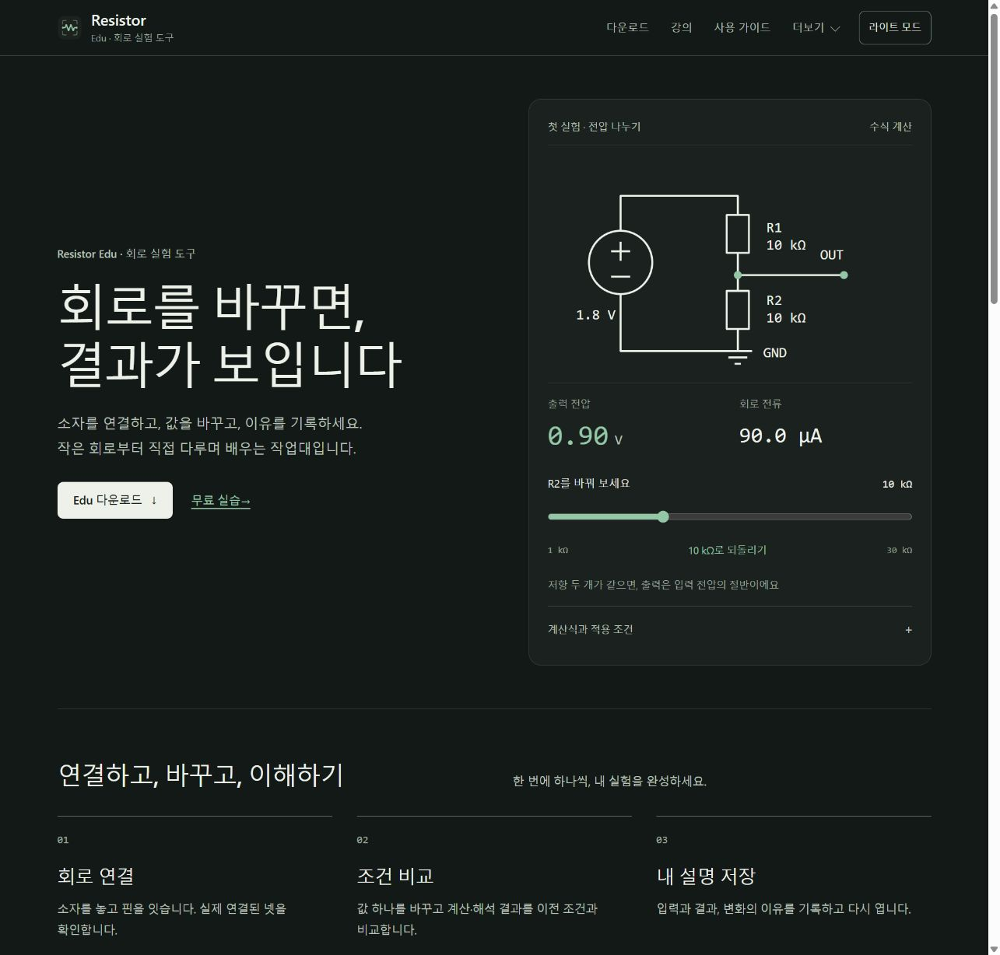

# Resistor Edu — 심플·명료·단순

## 적용 결과

웹사이트는 https://resistor.kr 및 https://resistor-downloads.vercel.app 에 배포했다.
배포 ID는 `dpl_41Di8CcUT1kiBcLkPsf4HSERC68e`다.
앱은 `codex/edu-simple-20261113` 소스와 기존 Edu 개발 작업 폴더에 반영했다.
공개 설치 파일 0.33.0을 교체하거나 새 버전의 설치 파일을 공개한 작업은 아니다.

- 홈은 퀴즈·공부 / 설계·시뮬레이션 두 선택으로 시작한다.
- 활동을 고르고 여는 흐름은 두 화면이다. 기존 확인 전용 세 번째 화면은 제거했다.
- 기록·리그·미리보기는 학습 도구에, 테마·버전·개인정보·시리얼은 설정에 둔다.
- 뒤로가기·Escape로 상위 화면으로 돌아간다. 기존 워크북·퀴즈 상태와 설계의 7단계 포인터를 보존한다.
- 밝은 종이색과 어두운 그래파이트, 녹색 강조를 웹·Edu 기본 테마·저항 아이콘에 적용했다. 기존 스킨과 시스템 테마 선택은 유지한다.
- Edu의 저장된 테마를 첫 화면부터 적용한다. Industry의 저장 키와 선택은 덮어쓰지 않는다.
- SVG 원본에서 Windows ICO, macOS ICNS와 PNG를 생성했다. 재현 가능한 resvg 렌더러를 사용한다. 설치된 앱 아이콘이 자동으로 갱신됐다는 의미는 아니다.

## 덜 방해하는 온라인 확인

앱 시작을 가리는 연령 화면과 상시 배너를 제거했다. 로컬 화면은 즉시 표시하며,
인증·외부 AI·리그·공동 설계 등 온라인 작업을 직접 실행할 때만 자기 확인창을 연다.
생년월일·신분증을 받지 않으며 저장된 확인을 다음 실행에 재사용한다.
취소하면 대기 중인 요청을 보내지 않고 현재 작업을 유지한다.
자동 리그 조회와 공동 설계 복원은 확인창을 갑자기 열지 않는다.

만 14세 이상 온라인 정책, host의 전송 경계, 기존 시리얼 검사는 유지한다.
확인을 라이선스나 AI 전송·비용의 일괄 동의로 사용하지 않는다.
기존 공개 앱에 새 서버 필수 필드를 강제하거나 유효 사용권을 취소하지 않았다.
자세한 경계는 [전환 문서](edu-online-access-migration-20261113.md)에 기록했다.

## 웹 공개 검증

기존 production 297개 파일을 해시로 복원한 후 143개 표시 파일만 변경했다.
140개 HTML의 공통 탐색을 다운로드·강의·사용 가이드로 정리했다.
고급 자료, 강의 목차와 배포 상세는 기본 접힘이다.
남은 154개 파일, API 출력·라우팅·설정·다운로드/자동 업데이트 메타데이터는 보존했다.
기존 배포 버전 안내 원문은 접힘 영역에 보존했다.
약관·개인정보의 main 본문은 문자 비교로 동일함을 확인했다.
정책 검토 상태와 미확정 시행일, 유료 서명·공증 보류 상태를 바꾸지 않았다.

## 검증

| 검사 | 확인 결과 |
| --- | --- |
| 핵심 검사 | 607/607 통과 후 포커스 관련 국소 보완 |
| 최종 요청 경계·UI·클라우드 검사 | 21/21 통과, 추가 origin 포커스 회귀 포함 |
| 사이트·문서·정책·Edu shell 검사 | 23/23 통과 |
| 최종 타입 검사·빌드 | 통과, 기존 500 kB 초과 bundle 경고 유지 |
| 공개 양쪽 도메인 검사 | 74/74 통과 |
| 전체 140개 HTML 내부 경로 | 깨진 경로 0, 정책 본문 변경 0 |
| 실제 브라우저 | 홈→활동 선택→워크북, 설정→밝기→스킨→복귀, 리그 진입 시 자동 확인창 없음, 직접 연결 후 취소·현재 화면 보존 |
| 모바일 | 폭 390에서 Edu 문서 폭 390, 사이트 문서 폭 375; 메뉴 열기·Escape 닫기, Edu 단계별 상위 복귀 확인 |
| 웹 분압기 | R1=10 kΩ, R2=20 kΩ, Vin=1.8 V에서 1.20 V와 60.0 µA |

학습 UI 검수는 별도 로컬 workspace와 실제 Edu 컴포넌트·학습 서비스를 사용했다.
인증·EDA 해석·외부 AI는 이 UI harness에서 실행하지 않았다.
별도 정식 web 진입점에서는 미인증 상태와 host 상태 조회, 확인창 취소·시리얼 화면 유지까지 확인했다.
이 결과를 새 설치 앱 4개 OS 실행, 실제 엔진 검증 또는 제조 승인으로 확대하지 않는다.

기존 작업 폴더에는 부모 소스와 동일한 33개 파일 및 신규 2개 파일을
`git apply --check`로 대조한 후 적용했다. 다른 작업, 키, 프로젝트와 학습 기록은 수정하지 않았다.
5187 개발 서버가 새 활동 선택 소스를 제공하는 것을 HTTP로 확인했다.

## 실행과 다음 배포

현재 개발 앱: http://127.0.0.1:5187/eda

별도 개발 환경에서는 의존성 설치 후 `npm run dev:edu`를 사용한다.
외부 엔진과 시리얼 조건은 기존 실행 절차를 따른다.
이번 디자인을 다운로드 설치본에 넣으려면 별도 버전으로 OS별 빌드·실행 검증·릴리스가 필요하다.
기존 0.33.0 파일을 같은 이름으로 덮어쓰지 않는다.

디자인 방향: 회로 실험 도구 / 차분함·정확함·친근함 / 실험 노트와 작업대 /
회로·수치가 중심 / 같은 저항 표식.
간격·색상·아이콘·문구·타이포·구성 기준에는
[unslop — Damir Sokolovsky](https://heydamir.design/unslop), CC BY 4.0을 적용했다.

