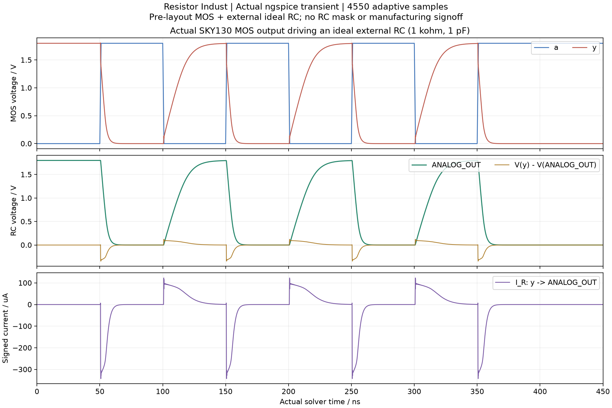

# Resistor Indust · HDL과 아날로그/디지털 통합 설계

**프로젝트 도구 → HDL·Mixed SoC**에서 소스 파일, 입력 벡터, 실제 합성·시뮬레이션과 파생 회로/레이아웃을 연결합니다. 기존 가산기·CPU 템플릿과 계산기는 그대로 유지합니다. 소스·기하·엔진은 Edu/Indust가 공유하는 구현이며, 워크스페이스와 사용자 데이터는 각 edition에 남습니다.

## 언어별 실제 처리 경로

| 입력 | 처리 | 현재 범위 |
|---|---|---|
| Verilog | Yosys + Icarus Verilog | 합성 가능한 RTL, 여러 파일, 조합/순차 회로, 로컬 memory data |
| SystemVerilog | Yosys `read_verilog -sv` + Icarus `-g2012` | 설치된 도구의 합성 가능 부분집합. UVM이나 전체 SV 표준 구현을 뜻하지 않음 |
| VHDL-2008 | GHDL 합성 → 생성 Verilog → Icarus | VHDL 합성 의미의 벡터 검사. 원본 VHDL testbench를 직접 실행한 결과와 구분 |
| VHDL + Verilog/SV | GHDL entry entity와 Verilog wrapper | 서로 연결한 실제 다중 언어 논리의 합성·벡터 검사 |
| C | 검증한 uint32 frontend → Verilog + 독립 GCC oracle | stateless unsigned 32-bit 조합논리. 아래 제한 참조 |
| RTLIL / BLIF | Yosys native frontend + 실제 gate netlist / simcells | 합성·벡터 검사·지원 게이트의 CMOS 변환 |
| SPICE | flat subcircuit → 검증된 editable primitive mapping | 공개 SKY130 MOS/R/C와 명시적 값. 미지원 model/directive나 parameter 손실은 차단. 아날로그 source/testbench는 공통 Simulation에서 설정 |
| `.mem` / `.hex` | 프로젝트에 포함된 로컬 memory 초기화 | 외부 파일 경로를 임의로 읽지 않음 |

SystemC/C++, Chisel, SpinalHDL, Bluespec은 별도 frontend가 생성한 Verilog/SV를 가져옵니다. 해당 compiler를 이 앱이 실행·검증했다고 표시하지 않습니다. Verilog-AMS와 전체 상용 HLS, 임의 C 프로그램은 이 경로의 지원 대상이 아닙니다.

참고한 도구의 공식 문서: [GHDL synthesis](https://ghdl.github.io/ghdl/using/Synthesis.html), [Yosys frontends](https://yosyshq.readthedocs.io/projects/yosys/en/stable/cmd/index_frontends.html), [Yosys mapping passes](https://yosyshq.readthedocs.io/projects/yosys/en/stable/cmd/index_passes_techmap.html), [Icarus Verilog](https://steveicarus.github.io/iverilog/), [ngspice](https://ngspice.sourceforge.io/docs.html). 이 앱의 mixed RC 실험은 [XSPICE event-driven simulation](https://ngspice.sourceforge.io/xspice.html)을 사용한 결과가 아닙니다.

## 빠른 시작

1. **시작 예제**에서 Verilog inverter, SV 가산기, 카운터, VHDL 가산기, C ALU, ROM, RTLIL, BLIF 또는 SPICE를 선택합니다.
2. Top module/entity/function, 파일, 벡터 간격과 칩 폭·높이를 확인합니다. VHDL+Verilog 혼합 설계는 VHDL entry entity를 따로 입력합니다. VHDL package 등 의존 파일은 해석 순서대로 구성합니다.
3. **새 HDL 프로젝트로 저장**합니다. 기존 프로젝트를 덮어쓰지 않습니다. 이후 **현재 소스 저장**은 새 revision을 생성합니다.
4. **벡터 시뮬레이션**을 실행합니다. 현재 상태·원본 로그·출력 assertion 개수·실제 VCD가 표시됩니다. 편집 중인 소스와 저장된 결과를 구분합니다.
5. **논리 합성·CMOS 변환**은 실제 Yosys gate를 편집 가능한 CMOS 계층과 SPICE로 바꿉니다. 합성 완료의 분석 결과는 `unknown`이며 전기적 PASS가 아닙니다.
6. **실제 참조 레이아웃 생성**은 공개 SKY130 PCell과 배선을 생성합니다. 포트 연결·primitive 수·영역과 실제 도형을 미리보고 **승인·현재 작업대에 적용**합니다. 적용은 Undo 가능하며 기존 실행은 revision 차이로 STALE이 됩니다.

입력 벡터의 값은 문자열입니다. 32/64-bit 정수도 JavaScript의 부동소수점 반올림 없이 보존합니다.

```json
[
  {"inputs":{"a":"15","b":"1"},"expect":{"sum":"16"}},
  {"inputs":{"a":"15","b":"15"},"expect":{"sum":"30"}}
]
```

각 행에서 모든 입력을 명시합니다. 출력은 해당 간격 이후 검사하며 `!==` 비교로 X/Z도 실패시킵니다. 기대 출력이 없으면 실행만 완료하고 PASS는 만들지 않습니다. C는 실제 GCC 실행의 계산값을 독립 기대값으로 사용합니다. VCD의 X/Z와 실제 종료 시각을 보존하며 마지막 값이 유지되는 구간을 임의로 잘라내지 않습니다. 화면의 bus 숫자는 unsigned decimal이고 원본 bit pattern은 VCD에 남습니다.

`gates.v`, `vector_tb.sv` 같은 runner 출력 파일명은 입력에 사용할 수 없습니다. 해당 오류가 나오면 소스 편집기에서 입력 파일 이름을 바꾸세요. 원본 HDL은 프로젝트의 immutable revision에 별도로 보존합니다.

## C 하드웨어 부분집합

```c
#include <stdint.h>
uint32_t c_alu(uint32_t a, uint32_t b, uint32_t sel) {
    uint32_t y = (a + b) & 15u;
    if (sel != 0u) y = (a ^ b) & 15u;
    return y;
}
```

- 한 함수, uint32_t/unsigned int 입출력, 초기화된 지역 변수, 대입, if/else, 삼항식, unsigned 산술·비트·비교 연산을 지원합니다.
- 상수는 `15u`, `0xffu`처럼 unsigned로 명시합니다. C의 octal 의미도 유지합니다. 각 RTL 중간 값은 32-bit로 고정하여 modulo 2³² wrap을 보존합니다.
- shift는 0u..31u 상수만 허용합니다. 포인터·배열·loop·동적 메모리·static state·함수 호출·signed/float·division은 현재 거부합니다.
- 임의의 C를 문자열 치환으로 HDL로 바꾸지 않습니다. AST 검사 후 SSA 값을 생성하며, 벡터 검사는 별도로 GCC가 원본 C를 컴파일·실행한 값과 대조합니다. 이 결과가 전체 C 프로그램의 HLS 지원이나 수학적 동치 증명을 뜻하지는 않습니다.

## 아날로그/디지털 통합과 레이아웃

CMOS 결과를 적용하면 기존 회로도·Layout 2D·Layout 3D·DRC/LVS/PEX·GDS/OASIS 내보내기를 사용합니다. 원본 HDL 파일과 bus↔scalar port mapping을 프로젝트 ZIP에 함께 보존합니다. 회로도나 레이아웃의 직접 편집은 파생 snapshot 편집이며, HDL 소스로 자동 역변환하는 기능이 아닙니다.

참조 CMOS 변환은 각 출력 scalar port를 별도 net으로 유지하기 위해 두 inverter로 구성한 BUF를 추가합니다. 그 부하와 지연이 포함된 참조 회로이며, 원본 RTL의 지연이나 최적화된 표준셀 면적과 같다고 간주하지 않습니다. 공통 회로도의 디지털 블록 핀 방향은 compiler가 기록한 실제 입력·출력과 scalar mapping에서 전달합니다.

**새 SoC 조립 프로젝트**는 별도의 1mm² envelope를 만들고 현재 블록을 계층 가져오기 대상으로 연결합니다. 아날로그와 디지털 블록의 회로·실제 마스크를 함께 복사하고, 위치·회전·핀 연결·전체 mask 영향을 미리봅니다. 원본 HDL과 source revision은 각 instance의 `integration_bindings`에 보존합니다. 저장·재가져오기도 이 연결을 유지하며 이전 PASS를 상속하지 않습니다.

계층 가져오기의 현재 전체 영향 한도는 100,000 native shapes입니다. 블록 사이의 물리 배선을 자동으로 만들지는 않습니다. 조립한 SoC 전체를 검증한 것으로 표시하지 않으며, 전원·신호 배선을 실제로 완성한 뒤 전체 DRC/LVS/PEX를 다시 실행해야 합니다.

현재 내부 physical adapter는 최대 **512 MOS/passive primitives**, 합성 분석은 최대 20,000 gates, 128 ports/8,192 port bits와 포트당 256 bits입니다. 기본 칩 규격은 1,000×1,000µm, 면적 1mm², edge 10µm입니다. 도형을 잘라 넣거나 축소하지 않고 실제 envelope를 검사합니다. 대규모 표준셀 P&R, CTS, STA, full-chip timing closure는 별도 implementation backend와 검증이 필요합니다. OpenROAD가 없으면 UI에 미설치로 표시합니다.

## 디지털 구동 + 아날로그 RC 실험

적용한 HDL inverter에서 실제 출력 `y`, R=1kΩ, C=1pF를 선택하고 **디지털 구동 + 아날로그 RC 시험 프로젝트 생성**을 누릅니다. 원본은 남고 새 프로젝트가 열립니다. 공통 **Simulate**에서 실제 SKY130 MOS와 이상적 외부 RC를 한 ngspice 회로로 풉니다.

벡터가 실제 입력 PWL source로 연결되며 source rise time에 맞춘 maximum step을 사용합니다. 전압·전압 강하와 signed branch current를 기존 파형/Signal flow에서 확인합니다. 외부 RC의 R×C는 1ns지만 실제 출력 응답에는 MOS driver의 유한 구동 저항·기생과 부하 효과가 함께 들어갑니다.

이상적 RC와 외부 입력 source는 실제 RC mask를 생성하지 않습니다. 조립 전 디지털 geometry만 유지되므로 해당 RC의 physical mapping이나 전체 LVS/PEX는 미완료입니다. RC에 대한 전류 화살표의 공간 대응도 추정하지 않습니다.



## 설치·검증·원본

Docker 없이 설치된 native/WSL 도구를 사용합니다. Ubuntu/WSL에서는 공식 패키지의 `yosys iverilog ghdl gcc`와 native engine Python의 `pycparser==2.22`가 필요합니다. CMOS 생성/해석에는 기존 public SKY130, Magic, ngspice, Netgen 구성이 필요합니다. macOS는 동일 도구의 native 설치 경로를 연결합니다. 이 패치가 새 OS별 installer를 발행했다는 뜻은 아닙니다.

```sh
npm run test:hardware       # 별도 Indust lab에서 native 실행, 실제 도형·저장·연동 검증
npm run test:hardware:mcp   # 실제 MCP client → worker → VCD
npm run typecheck
npm run build
```

공개 source/프로젝트: [hardware lab](../examples/hardware-lab/README.md). 실제 결과와 실패: [qualification.json](../examples/hardware-lab/qualification.json). 전체 입력 범위·PVT·잡음·수율·상용 엔진·제조 signoff와 새 installer 출시는 별도입니다.
