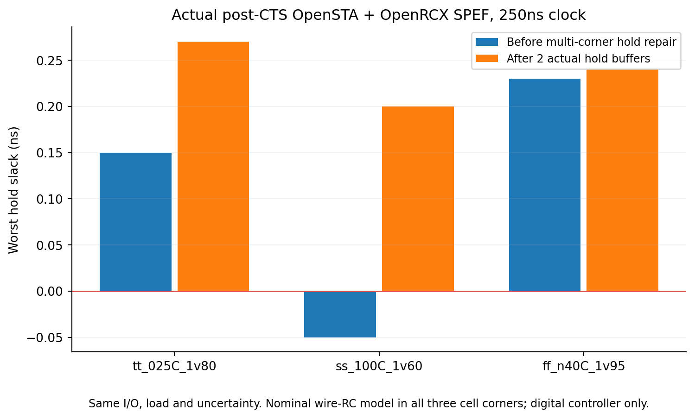
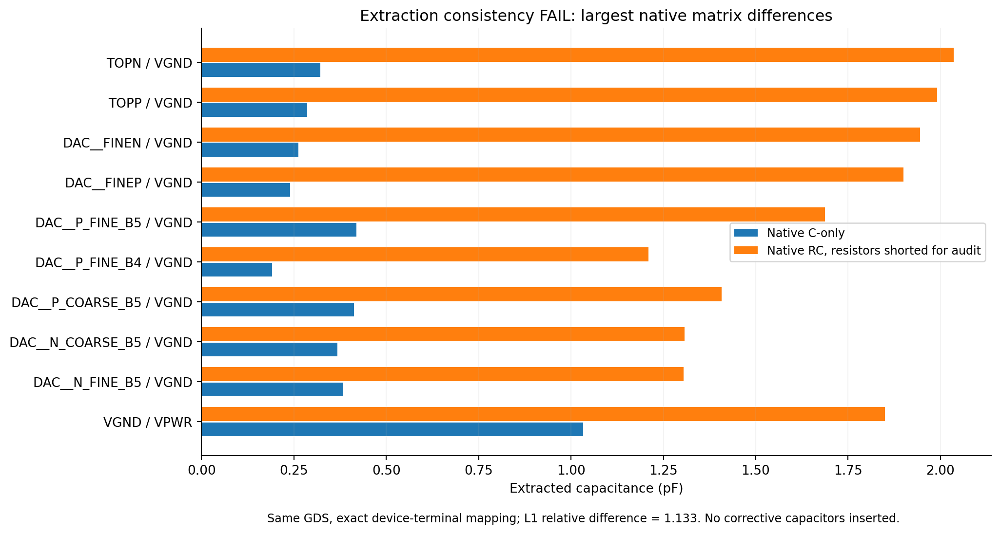

# Resistor Indust · 논문 기반 SAR12 검증

2026-10-20, `codex/resistor-indust`. 공개 엔진으로 실제 실행한 결과이며 **제조 signoff는 미완료**입니다. [원본·그래프·결과 묶음](../examples/paper-signoff/README.md).

## 논문에서 적용한 내용

Kentaro Yoshioka, [The Era of Vibe Tapeout: Dark Age or Golden Age for Analog Circuit Design?](https://arxiv.org/abs/2610.15240), arXiv:2610.15240v1, 2026-10-11. [본문 III-D/III-E 및 CP-A/B/C](https://arxiv.org/html/2610.15240v1)를 참고했습니다.

논문은 11-bit, 5.12MS/s SAR ADC입니다. 저희의 기존 **12-bit 차동 6+6 CDAC**는 다른 설계이며 논문 회로의 재현품이 아닙니다. 배치 대칭과 민감 노드 검토, 독립 추출 비교, 비교기 공통 모드 의존성, 검사로 발견한 실패 원인을 분리해 검증하는 접근을 적용했습니다. 논문에서 경고한 결합 C의 접지 치환 문제 때문에, RC 소자 개수만으로 추출 정확성을 판정하지 않습니다.

| 조건 | 논문 기준 | 현재 Resistor SAR12 |
|---|---|---|
| 해상도·속도 | 11-bit · 5.12MS/s | 12-bit · 기존 아날로그 bridge 약 99.5kS/s |
| 전원 | 1.8V | 아날로그 sweep 1.8V; 디지털 라이브러리 코너는 아래 별도 |
| 동적 성능 | post-PEX TT, 256점 coherent FFT, −1dBFS, SNDR≥60dB/SFDR≥70dB | 해당 조건의 배선 후 FFT 미측정 |
| 전력·면적 | ≤450µW · ≤0.14mm² | 같은 목표 달성 미검증; 기존 아날로그 마스크 약 0.6046mm², 디지털 전용 시험 die 0.0144mm² |

논문의 수치나 과거 64점 pre-layout FFT를 이번 설계의 배선 후 ENOB로 표시하지 않습니다.

## 실제 끝낸 검증

- **아날로그 매크로:** 새 revision 1 프로젝트에서 Magic `drc(full)` 위반 0개, Netgen LVS 일치, Magic PEX 61,144R / 17,199C를 다시 실행했습니다. 각 manifest에 원본 OAS/GDS, 도구, PDK, 52개 adapter source hash가 있습니다.
- **비교기:** 실제 PDK MOS transient **702회**. TT 27°C / SS 125°C / FF −40°C, 공통 모드 0.75–1.5V의 6점, 13개 차동 입력. 명시적인 latch QP/QN +0.5fF 민감도 실험을 포함합니다. 702회 수렴, 큰 ±8LSB 입력 108점 극성 일치, 0차동 TT/1.20V 1점은 0.55µs 판정 시점 미해결입니다. 통계적 mismatch·noise·수율 검증은 아닙니다.
- **제어기 물리 구현:** 실제 RTL을 SKY130 HD로 합성하고 OpenROAD로 배치, tap, clock tree, setup/hold repair, filler, 전원 ring/stripe, 상세 배선, OpenRCX 추출까지 수행했습니다. 120×120µm die, 177개 추출 net, 958 R segment / 958 ground-cap records / 1,366 coupling-C records입니다. GDS에는 실제 표준셀 트랜지스터 마스크와 34개 고유 외부 핀 이름이 포함됩니다.
- **디지털 mask DRC/LVS:** router 최종 위반 0개와 별도로, GDS를 독립 Magic `drc(full)`로 검사해 위반 0개, Netgen으로 트랜지스터 회로를 비교해 일치했습니다. 양 전원망의 형상 연결 검사와 antenna 검사도 통과했습니다. IR drop·EM·package 전원 무결성을 뜻하지 않습니다.
- **논리:** 합성 게이트와 배선 후 실제 게이트 각각 4,096코드·159,751 assertion, 합계 **319,502 assertion** 통과. X comparator 대조군은 실패를 검출했습니다. 디지털 oracle이며 4,096회의 아날로그 ADC 변환이 아닙니다.

GDS 내보내기에서 처음 누락되었던 핀 purpose/label을 수정했습니다. LVS는 원본 표준셀 SPICE를 보존하고, 별도 참조 뷰에서만 설치된 공개 Magic 기술 파일의 `w<0.42µm` 규칙대로 4개 좁은 nfet의 모델 분류를 맞췄습니다. W/L·단자·연결은 바꾸지 않고 class alias나 ignore waiver도 추가하지 않았습니다. MOS 폭 20% 변조 대조군은 실제 Netgen의 property 오류로 거부되었습니다.

## 배선 후 STA와 수정한 실패

독립 **OpenSTA 3.1.0**, 실제 CTS와 추출 SPEF를 사용했습니다. 250ns clock, 신호 input/output max 25ns / min 0.5ns, 입력 transition 0.1ns, 출력 load 0.01pF, setup/hold uncertainty 0.5/0.1ns입니다. false-path 면제는 없습니다.

| 디지털 cell corner | 배선 후 setup slack | 배선 후 hold slack |
|---|---:|---:|
| TT · 25°C · 1.80V | 223.46ns | 0.27ns |
| SS · 100°C · 1.60V | 222.63ns | 0.20ns |
| FF · −40°C · 1.95V | 223.79ns | 0.24ns |

첫 TT 중심 구현은 SS hold **−0.05ns**로 실패했습니다. 입력 지연이나 uncertainty를 완화하지 않고 다중 코너 최적화와 실제 hold buffer 2개로 고쳤습니다. 실패 당시 로그·netlist·SPEF와 최종 결과를 모두 보존했습니다. 0.2ns clock 대조군은 배선 전후 모든 코너에서 실제 timing 실패를 검출했습니다.



이 결과는 **제어기 전체 digital top**의 STA입니다. 전체 아날로그 ADC/SoC의 timing closure가 아닙니다. 동일한 nominal wire-RC 모델을 3개 cell corner에 사용했으며 multi-RC corner, OCV, SI/crosstalk noise, analog timing arc는 포함하지 않습니다. OpenRCX의 0.1fF 미만 coupling grounding과 OpenSTA의 정적 coupling reduction도 명시된 모델 제한입니다.

신호 timing view는 OpenROAD가 내보낸, 내부 논리 연결이 없는 VPWR/VGND 포트 선언만 제거합니다. 다른 용도로 사용되면 스크립트가 중단됩니다. PG를 포함한 원본 netlist는 LVS용으로 별도 보존합니다. SPEF annotation에서 제외된 3개 `clkload*/Y`는 출력 연결 자체가 없는 CTS 부하 인버터입니다. 연결된 177개 net은 추출되며 부분 annotation driver는 0개입니다.

## 발견한 아날로그 PEX 차단 항목

동일 GDS에서 C 전용 추출과 distributed RC 추출을 별도로 생성했습니다. 실제 저항만 short한 연결 성분에 대해 **729개 소자의 동일 인스턴스·동일 단자**로 원래 net을 대응시켰습니다. W/L/소자 parameter 차이 0개, 매핑되지 않은 C 0개입니다. 추측한 net 이름이나 보정 C는 사용하지 않았습니다.

| 항목 | 실제 값 |
|---|---:|
| C 전용 행렬 합 | 21.32254272pF |
| RC를 lump한 행렬 합 | 44.95016778pF |
| 행렬 절대 차이 L1 | 24.16897614pF |
| C 전용 합 대비 상대 L1 | 1.133494, 즉 약 113.35% |
| 원래 존재했지만 RC에서 없는 pair | 59개 |

행렬 합은 모든 pair C를 합한 진단량이며 ADC 입력의 등가 C가 아닙니다. 이 차이가 전부 결합 C 하나의 원인이라고 단정하지 않습니다. 추출 모드별 capacitance accounting/분배를 해결하기 전에는 **coupling 보존 정밀 PEX 검증 실패**로 처리합니다. RC를 임의 수정하거나 이를 근거로 SNDR 통과를 선언하지 않았습니다.



## 남은 제조 차단 조건

1. 아날로그 결합 C와 저항망의 공간적 배분을 검증하고, 올바른 추출망에서 256점 이상의 배선 후 ADC FFT·정적 선형성을 측정해야 합니다. 현재 긴 MOS 해석의 수치 결과를 단축하거나 추정값으로 대체하지 않았습니다.
2. 디지털 RTL의 한 acquisition cycle과 기존 아날로그 bridge의 4µs acquisition, comparator 판정 시점/동기화, trial/eval 인터페이스를 하나의 실제 closed-loop testbench로 묶어야 합니다. 디지털 250ns clock 통과가 ADC sample rate 4MHz 달성을 뜻하지 않습니다.
3. 아날로그·디지털·pad/ESD·package의 실제 연결과 전체 chip LVS/STA, RC corners, IR/EM, density/fill, latch-up/antenna/reliability 및 foundry 승인 검증 deck이 필요합니다.
4. 공개 GDS·기술 파일, ORFS TT Liberty/LEF, SkyWater SS/FF characterization은 각각 고정된 공개 소스와 hash로 기록했습니다. 이 여러 공개 릴리스의 제조용 조합 자격은 검증하지 않았습니다.
5. 현재 ResistorEDA worker PATH에서 상용 실행 파일 17종이 발견되지 않았습니다. 원격 서버 전체 검색이나 license 상태 확인은 하지 않았고, 상용 실행은 `not_run`, 승인 deck은 `not_provided`입니다. 기존 backend adapter가 있다는 이유로 상용 검증 완료로 표시하지 않습니다.

## 재현

현재 검증 환경은 native Linux/WSL `ResistorEDA`이며 Docker를 사용하지 않았습니다. ngspice, Yosys, Icarus, Magic, Netgen, KLayout과 SKY130A가 설치된 engine Python을 사용합니다. 추가 도구는 아래 공개 소스입니다.

- OpenSTA: [공식 소스](https://github.com/The-OpenROAD-Project/OpenSTA/tree/a847ec7a1413dbdcbc8a4f44a50bcea50f2db82a), 3.1.0. CUDD 3.0.0 shared library 경로를 스크립트가 설정합니다. GPLv3 바이너리는 결과 ZIP에 재배포하지 않습니다.
- OpenROAD: [공식 설치 안내](https://openroad.readthedocs.io/en/latest/user/Build.html)가 연결하는 Precision Innovations 배포본, `26Q2-1164-g08f67ee5ec`. 다운로드 receipt에 URL·크기·SHA256이 있습니다.
- [ORFS 공개 SKY130 HD 플랫폼](https://github.com/The-OpenROAD-Project/OpenROAD-flow-scripts/tree/bf3f9b344bf7d9d999f199778a722833bccbd33c/flow/platforms/sky130hd)과 [공개 characterization](https://github.com/google/skywater-pdk-libs-sky130_fd_sc_hd/tree/ac7fb61f06e6470b94e8afdf7c25268f62fbd7b1), [공식 Liberty formatter](https://github.com/google/skywater-pdk/tree/7198cf647113f56041e02abf3eb623692820c5e1/scripts/python-skywater-pdk).

엔진 Python/작업 경로가 다른 환경은 해당 경로를 사용합니다. 아래 명령은 저장소 root의 native Linux shell 기준입니다.

```sh
PY="$HOME/.local/share/resistor/engine/bin/python3"
"$PY" -m pip install -r scripts/requirements-paper-qa.txt
"$PY" scripts/paper-run.py
```

이 명령은 공개 입력을 준비하고 디지털 flow를 순서대로 재실행합니다. `.runtime/paper-signoff/`에 로그·GDS·DEF·ODB·Verilog·SDC·SDF·SPEF가 생성됩니다. 스크립트 종료 성공은 각 분석의 PASS와 구분합니다. 분석 결과는 `timing/report.json`, `mask-drc/report.json`, `digital-lvs/report.json`에서 확인합니다.

기존 SAR12 아날로그 예제를 새 프로젝트로 가져온 뒤 DRC/LVS/PEX를 직접 실행하면, 그 **현재 PEX run id**로 비교할 수 있습니다.

```sh
"$PY" scripts/paper-coupling-qa.py --run <현재_32자리_PEX_run_id>
"$PY" scripts/paper-comparator-qa.py
"$PY" -m unittest discover -s tests -p test_paper_signoff.py -v
```

702회 sweep은 몇 분이 걸립니다. 제품 worker/기존 프로젝트를 덮어쓰거나 과거 PASS를 새 revision에 상속하지 않습니다. 앱에서 파일 가져오기는 새 프로젝트로 하며, OpenROAD 전용 배선/STA 스크립트가 모든 엔진 API의 일반 기능으로 연결되었다고 주장하지 않습니다.
