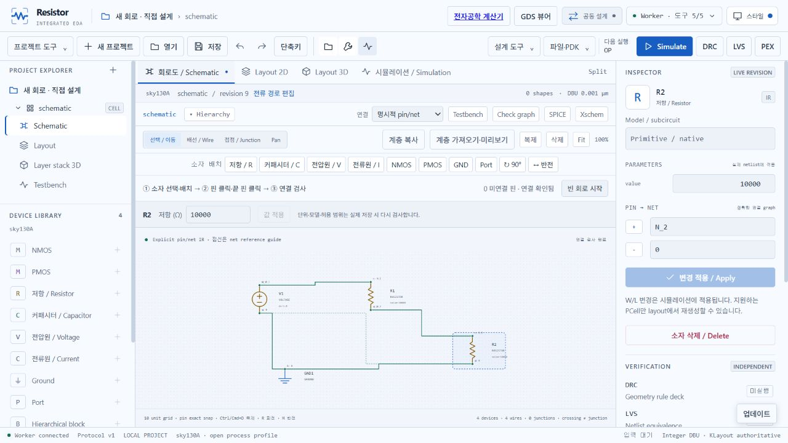

# 기본 회로도 빠르게 그리기

**Schematic → 빈 회로 시작**에서 새 프로젝트를 만듭니다. 현재 프로젝트는 덮어쓰지 않습니다. 처음에는 소자와 레이아웃이 없고 기본 해석은 DC 동작점(OP)입니다.

1. 상단 **저항 / R**을 누르고 `10kΩ`를 입력합니다. 캔버스를 클릭해 두 개를 배치합니다. 같은 값으로 반복 배치하며 Esc로 끝냅니다.
2. **전압원 / V**에 `1.8V`를 입력해 배치하고 GND도 배치합니다. 값·단위는 배치 전에 바꿀 수 있습니다.
3. 선택 모드에서 V1의 `+` 핀 → R1의 `+` 핀을 클릭합니다. 두 핀 사이에 배선과 같은 노드가 한 번에 저장됩니다.
4. R1 `−` → R2 `+`, V1 `−` → GND, R2 `−` → GND를 연결합니다. 핀은 Tab으로 이동하고 Enter로 선택할 수도 있습니다.
5. **연결 검사**에서 미연결 핀이 0개인지 확인합니다. Simulate를 누르면 실제 ngspice 동작점에서 중간 노드는 0.9V, 저항의 전류는 90µA입니다. 수치는 실제 전압·전류 흐름과 동작점 결과에서 확인합니다.

새 소자는 임의의 접지·전원을 갖지 않습니다. 주황색 핀은 미연결입니다. 서로 다른 이름의 노드, 다른 핀을 지나가는 배선, stale revision은 저장 전에 차단됩니다. 선이 교차하기만 하면 접점으로 만들지 않습니다. 자동 꺾임이 다른 핀에 닿으면 Space로 방향을 바꾸거나 중간점을 클릭해 우회합니다.

소자를 선택하면 캔버스 위에서 값을 수정할 수 있습니다. `10k`, `4.7nF`, `1.8V`, `−2mA`(입력은 ASCII `-`), MOS 길이 `650nm` 또는 `0.65um`를 지원합니다. 잘못된 단위·0 이하 저항/용량/W/L·무한 값은 적용하지 않습니다. 값 입력란에는 저장된 수치를 그대로 사용하고, 심볼의 간단한 표시만 공학 표기로 줄입니다. 편집 중 다른 변경이 생기면 **현재 값 불러오기**로 확인합니다.

회전 R, 반전 M, 복제 Ctrl/⌘+D, Fit F, Undo Ctrl/⌘+Z를 지원합니다. [전체 단축키](shortcuts.md). 기존 노드 이름·모델·W/L·계층·연결 모드는 보존합니다. 명시적 pin/net 모드의 점선은 이름으로 공유되는 노드를 나타내는 안내선입니다.

현재 직접 작성 회로의 간편 수치 해석은 flat 회로의 명시적 DC 전원과 OP/정적 전원 transient를 지원합니다. 임의의 pulse·AC 자극·동작 합격 기준을 만들어 넣지 않습니다. 수치가 반환돼도 기능 검증 기준이 없으면 결과는 **미판정**입니다. 계층·외부 GDS의 포트 자극은 기존 **설계 도구 → 해석 설정**을 사용합니다.

회로도만 그린 상태에서는 DRC/LVS/PEX를 PASS로 만들지 않습니다. 실제 도형을 그리거나 [규격 레이아웃 변환](gds-schematic-conversion.md)을 적용한 뒤 각각 검사합니다. 변환된 전압·전류원은 외부 바이어스로 기록하며, post-layout에서는 실제로 분리된 추출 단자 이름을 표시합니다. 분산 배선의 여러 지점을 원래 노드의 한 전압으로 합치지 않습니다.

이 화면은 실제 앱 조작 기록입니다. 숫자·흐름은 ngspice 결과이며 장식용 파형을 만들지 않습니다. 제조 승인·Apple 공증은 별도입니다.
