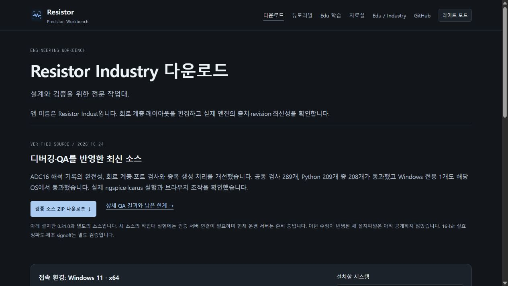

# Resistor Indust 검증 소스 · 공개 사이트 배포

2026-10-24에 [resistor.kr](https://resistor.kr/) 운영 배포를 완료했습니다. [Industry 다운로드](https://resistor.kr/download/industry/)에서 검증된 Indust 소스 `42b6d8650b2fdeaef572b305f320ec462e6b34dc`와 [상세 QA 범위](https://github.com/Lead729726-cell/Resistor/blob/42b6d8650b2fdeaef572b305f320ec462e6b34dc/docs/debug-qa-20261024.md)를 확인할 수 있습니다. Edu 소스와 기존 0.31.0 에디션 설치파일 10종의 URL·크기·SHA-256·검증 receipt는 유지했습니다.

이번 배포는 공유 다운로드 사이트와 Indust 소스 링크의 갱신입니다. **최신 수정이 포함된 새 설치파일은 배포하지 않았습니다.** 새 소스의 공식 시리얼 인증 서버는 아직 운영 환경에 연결되지 않았고, 해당 설치판의 배포 gate도 충족되지 않았습니다. 기존 0.31.0 설치파일은 계속 다운로드할 수 있습니다.

## 실행한 확인

- Indust 소스의 공통 검사 289개, Python 209개 중 208개가 통과했습니다. 건너뛴 Windows 전용 1개는 Windows Python에서 별도로 통과했습니다. 타입 검사·빌드도 통과했습니다.
- 새 격리 작업 공간에서 ngspice 커패시터·SAR16 ADC와 Icarus SAR 제어기 실행이 완료됐습니다. 짧은 해석 구간은 `failed/unknown`으로 남았고, 잘못된 ZIP은 프로젝트를 추가하지 않았습니다. 기본 SAR 입력 한 지점의 성공은 전체 입력 범위의 16비트 정확도를 의미하지 않습니다.
- 사이트 회귀검사 18개와 GitHub PR #6의 `core`·`tutorials` 검사가 통과했습니다. CI에는 두 에디션 빌드와 기존 실제 UI 시험도 포함됩니다.
- 배포 목록은 공개 파일 277개, 약 305MB입니다. 필수 항목 167개 중 누락이 없고 worker·키·사용자 작업 공간이 포함되지 않았습니다.
- 운영 도메인에서 익명 요청으로 68개 확인이 통과했습니다. 기존 설치파일 10종의 크기·GitHub asset digest·receipt SHA-256을 대조했습니다. 이번에 설치파일 전체를 다시 내려받거나 각 OS에서 재설치하지는 않았습니다.
- 튜토리얼 영상 3편은 운영 도메인에서 전체 파일을 내려받아 원본의 크기·SHA-256과 일치함을 확인했습니다. 소스 ZIP은 고정 commit·제품 identity·archive HEAD를 확인했으며 전체 ZIP 해시는 측정하지 않았습니다.
- 실제 브라우저에서 새 소스 안내, OS 5종의 선택 링크, Edu 페이지의 설치파일 5종, 자동 선택 복원을 확인했습니다. 준비본은 320px·390px 가로 넘침과 라이트 테마도 확인했습니다. 브라우저 console 오류는 없었습니다.

## 배포 기록

- Vercel 배포: `dpl_9JczzvzkE6fsagvFYEVV5gJWecZA` / `READY` / `production`
- 사이트 변경: [PR #6](https://github.com/Lead729726-cell/Resistor/pull/6), main 병합 `65da74a31f332b47c93edf5ab9988488114d517e`
- [배포 receipt](evidence/source-publication-20261024/deployment.json), [공개 확인 68개](evidence/source-publication-20261024/public-verification.json), [GitHub CI](evidence/source-publication-20261024/github-ci.json)
- [새 native smoke](evidence/source-publication-20261024/native-smoke.json), [사이트 검사](evidence/source-publication-20261024/site-tests.txt), [실제 공개 UI](evidence/source-publication-20261024/public-ui.json)

공개 확인은 저장소에서 `node scripts/verify-source-publication.mjs`로 다시 실행할 수 있습니다. 실제 DRC/LVS/PEX·상용 엔진·잡음·편차·지터·제조 signoff와 16비트 실효 정확도는 이 사이트 배포로 새로 충족되지 않습니다.
