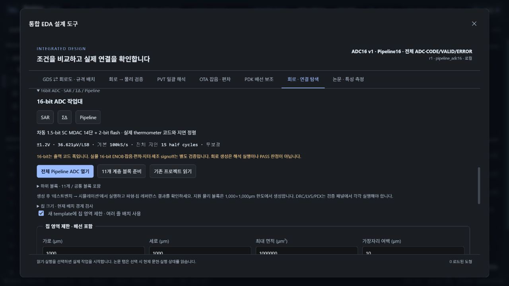

# Resistor Indust · ADC16 레퍼런스

16-bit **SAR / ΣΔ / Pipeline** 세 구조와 23개 편집 블록, 실제 아날로그 마스크 3개입니다. [사용법·계산·한계·참고 자료](../../docs/adc16-lab.md)를 먼저 확인하세요.

[회로·물리 프로젝트와 검증 요약 ZIP 받기](../Resistor-ADC16-Projects.zip). 큰 원본 파형과 GDS는 각 하위 폴더에 별도로 있으며 ZIP의 `ARCHIVE-SCOPE.json`에 원본 hash·다운로드 주소를 기록했습니다.

- [프로젝트 목록](projects/index.json): `.register.zip`을 앱의 프로젝트 가져오기로 여세요. OASIS·회로·PDK lock을 포함하며 엔진 PASS를 상속하지 않습니다.
- [native 실행](native/index.json): 입력/파형/판정/manifest. 큰 파일은 gzip입니다. `files.json`에 원본 크기와 SHA256을 기록합니다.
- [디지털 실제 검증](qa/verification.json): Pipeline 65,536코드, SAR 524코드, CIC 22,535samples의 RTL/gate/CMOS 재생.
- [17개 단독 블록 검사](qa/block-verification.json).
- [물리 DRC/LVS/PEX](physical/index.json): SAR analog, Pipeline stage, ΣΔ integrator. GDS.gz와 net metadata sidecar를 함께 제공합니다.
- [import·GDS roundtrip](import-exchange.json): 원본과 geometry/회로 일치, imported run 0개.
- [현재 회로와 원본 netlist 비교](source-compatibility.json): 세 아날로그 코어의 emitted SPICE byte 일치. 각 run의 역사적 source manifest는 별도 보존합니다.
- [오프라인 보정 분석](trim-study.json): 원래 raw 판정과 RTL을 변경하지 않습니다.

**남은 정확도 문제:** SAR 범위 끝 최대 19 LSB, ΣΔ DC 검사 최대 119 LSB의 무보정 오차가 있습니다. Pipeline의 최대 1 LSB 결과는 0.15V DC 한 조건입니다. 세 회로의 실물 16-bit ENOB·전체 INL/DNL·noise·mismatch·전체 ADC post-layout·제조 signoff는 미검증입니다.

## 필요한 실행 환경

현재 소스의 Resistor Indust, 공개 SKY130 PDK와 native Linux/WSL 도구가 필요합니다. [설치/실행](../../docs/native-runtime.md) · [엔진 검증 재현](../../docs/adc16-lab.md#재현). 이전에 게시된 설치 파일에 이번 ADC16 패치가 포함됐다고 가정하지 마세요.

프로젝트/검증 자료는 MIT 저장소의 생성 예제입니다. PDK 모델·상용 deck·라이선스·개인 설정은 포함하지 않습니다. [참고 출처](NOTICE.md).
