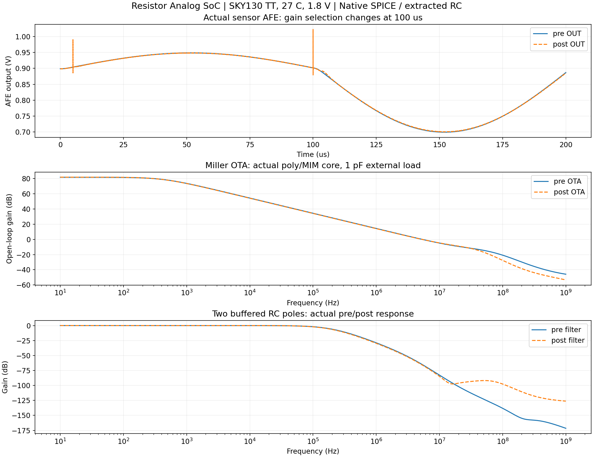
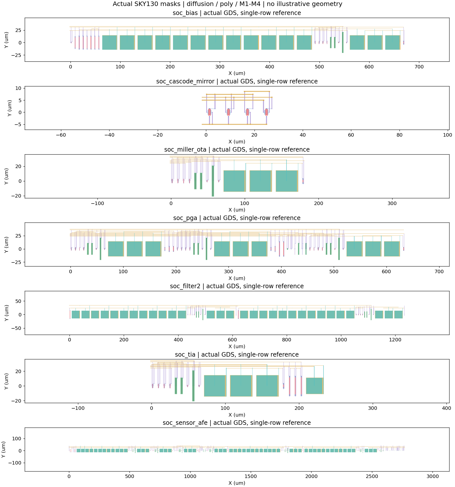

# Resistor · Analog SoC references

7개 실제 SKY130 매크로와 계층 회로·물리 프로젝트입니다. 바이어스, cascode mirror, Miller OTA, PGA, 2극 필터, TIA, 통합 센서 AFE를 제공합니다. ADC/CPU/패드가 통합된 완성 SoC는 아닙니다.

| 회로 | DRC/LVS/PEX | pre/post 파형 기준 |
|---|---|---|
| [SoC · 바이어스·공통모드 기준](soc_bias/README.md) | PASS | PASS |
| [SoC · 4-MOS 캐스코드 전류 미러](soc_cascode_mirror/README.md) | PASS | PASS |
| [SoC · 2단 Miller 보상 OTA](soc_miller_ota/README.md) | PASS | PASS |
| [SoC · ×2/×8 가변 이득 증폭기](soc_pga/README.md) | PASS | PASS |
| [SoC · 버퍼형 2극 active RC 필터](soc_filter2/README.md) | PASS | PASS |
| [SoC · 보상형 전류 입력 증폭기](soc_tia/README.md) | PASS | PASS |
| [SoC · 센서 AFE·클록 동기 판정](soc_sensor_afe/README.md) | PASS | PASS |

Nominal TT/27°C/1.8V. 18개 MOS corner/온도/전압 조건 중 18개 통과, 0개 기준 실패. 이득 허용 오차 3%. [실제 PEX 조건](pvt-pex.json)과 [OTA 잡음·편차·재현성](characterization/evidence.json)은 별도 기록입니다. 제조 승인과 전역 통계 수율은 미완료입니다. 이전 실패는 [v0.20 이력](history/v0.20.0/pvt.json)과 [수렴 보조 전 PEX 이력](history/v0.21-before-nodeset/pvt-pex.json)에 보존합니다.

[사용 절차·공식·제한](../../docs/analog-soc.md) · [원본 실행 기록](evidence.json) · [PVT 기록](pvt.json) · [하위 블록 목록](blocks.json)

