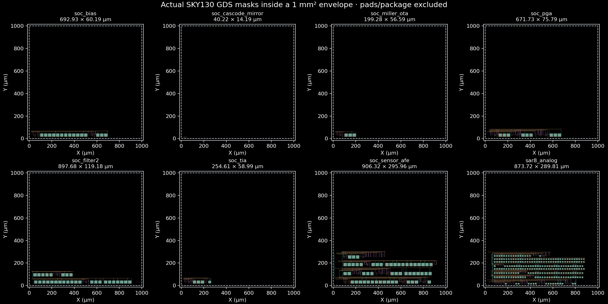
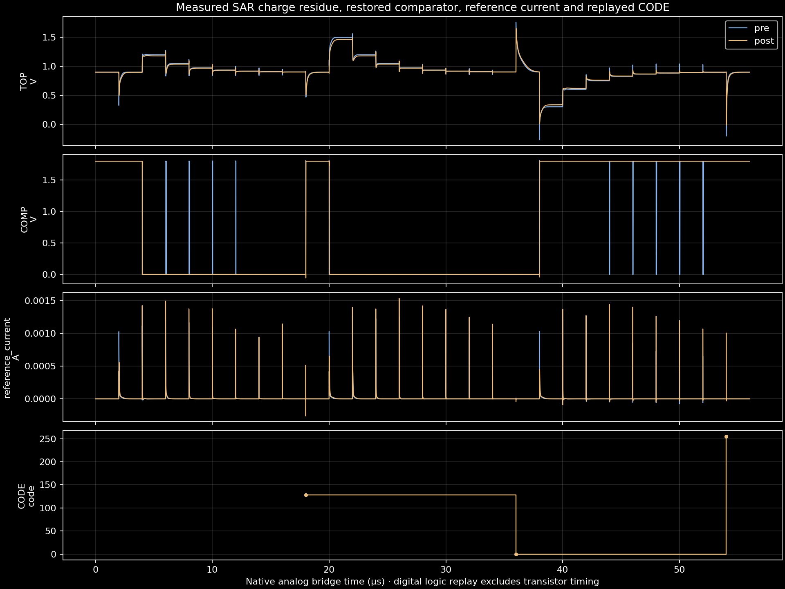

# Resistor · Bounded chip and SAR references

8 actual bounded SKY130 physical references plus 8 editable SAR blocks. Original projects are retained. Native 40/40 DRC/LVS/PEX/pre/post gates completed. SAR full static sweep: 259 inputs, maximum error 0 code. Post-layout SAR accepts ±1 code and unambiguous comparator levels; ENOB remains unmeasured.

[Guide](../../docs/sar-adc.md) · [Native job records](evidence.json) · [SAR blocks](blocks.json) · [Full-code sweep](sweep/result.json) · [Previous failures](history/README.md)

The archive contains the current references. Previous failed iterations are retained in the repository and originating worker, with source/run IDs. Digital controller masks and transistor timing, transition INL/DNL, coherent-tone SINAD/ENOB, noise/mismatch yield and manufacturing approval remain separate.
