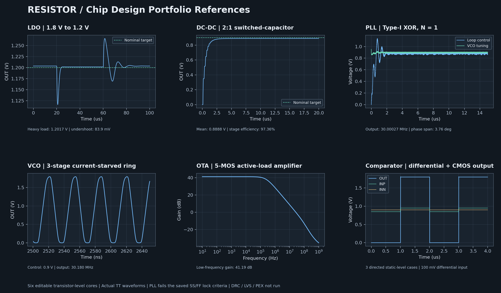

# 칩 설계 포트폴리오 레퍼런스

Resistor에서 열어 편집·해석할 수 있는 **SKY130 1.8V 칩 코어 6종**입니다.
[전체 ZIP](../Resistor-Chip-Portfolio.zip)에 프로젝트 ZIP, 계층 회로, 실제 testbench,
CSV 파형, PNG/SVG 그림과 검증 기록을 함께 넣었습니다.



| 레퍼런스 | 실제 TT / 27°C / 1.8V 관측값 | 포트폴리오 주제 |
|---|---|---|
| [LDO](chip_ldo/README.md) | 200µA 상당 부하에서 1.20166V, 부하 증가 시 약 83.94mV undershoot | 오차 증폭기, PMOS pass array, Miller·zero 보상, load regulation |
| [2:1 DC-DC](chip_sc_dcdc/README.md) | 평균 0.88883V, stage 효율 약 97.36% | 전송 게이트 4조, 비중첩 클록, charge transfer, 리플·전력 |
| [PLL](chip_pll/README.md) | 출력 30.00027MHz, 기준 30MHz, 마지막 관측 구간 위상 오차 span 3.76° | CMOS XOR, RC, 바이어스 감쇠, VCO, 잠금 조건과 PVT 한계 |
| [VCO](chip_vco/README.md) | CTRL 0.9V에서 약 30.1801MHz | 전류 제한 inverter, bias mirror, tuning, supply sensitivity |
| [OTA](chip_ota/README.md) | 저주파 이득 41.1874dB, −3dB 대역폭 약 236.78kHz | 차동 쌍, PMOS mirror 부하, 바이어스·동작점·AC |
| [비교기](chip_comparator/README.md) | ±50mV 입력 차이의 3개 지정 레벨 검사 통과 | 정적 differential preamp, CMOS 출력, threshold·지연·offset 확장 |

DC-DC 효율은 VDD에서 공급하는 **power stage** 기준입니다. 이상적인 외부 클록
드라이버의 소비 전력은 빠져 있으므로 완성 칩 효율로 쓰지 마세요. DC-DC는 개방루프
2:1 switched-capacitor 코어이며 인덕터 Buck 또는 폐루프 전압 조절기를 구현한 것이 아닙니다.

PLL은 **Type-I XOR, N=1** 기초 루프입니다. PFD/charge-pump/fractional-N PLL을
구현했다고 적을 수 없습니다. DUT의 XOR·VCO는 실제 MOS 계층으로 해석했습니다.
행동 전압원으로 출력 신호나 lock 결과를 만들어 넣지 않았습니다.

## 앱에서 만들기

1. 최신 저장소 소스로 Resistor와 EDA worker를 실행합니다.
2. **프로젝트 도구 → 내 반도체**에서 `칩 포트폴리오` 설계를 선택합니다.
3. 기본/저전압·고온/빠른 코너·저온 조건을 선택하고 새 설계를 만듭니다.
4. `생성 후 실제 해석도 실행하기`를 선택하거나 Simulation에서 Run analysis를 누릅니다.
5. 파형 아래 **칩 레퍼런스**의 실제 검사와 하단 측정값을 확인합니다.
6. MOS 크기·회로·보상 RC를 바꾼 다음 해석을 다시 실행하고 결과를 비교합니다.

ZIP을 가져올 때는 워크스페이스의 프로젝트 ZIP 가져오기를 사용합니다.
가져온 프로젝트의 과거 jobs는 0개이며 새 해석을 돌려야 합니다.
기존 공개 0.16.1 설치 파일에는 새 chip-template 어댑터가 없으므로 **최신 소스
엔진이 필요**합니다. 이번 작업에서 OS 설치 파일은 새로 배포하지 않았습니다.

## 실제 PVT 관측 결과

| 회로 | TT · 27°C · 1.8V | SS · 125°C · 1.62V | FF · −40°C · 1.8V |
|---|---|---|---|
| LDO | 4/4 | 4/4 | 4/4 |
| 2:1 DC-DC | 3/3 | 3/3 | 3/3 |
| VCO | 2/2 | 2/2 | 2/2 |
| PLL | 4/4 | **2/4 · 잠금 실패** | **2/4 · 잠금 실패** |
| OTA | 1/1 | 1/1 | 1/1 |
| 비교기 | 3/3 | 3/3 | 3/3 |

총 18개 실제 ngspice jobs가 실행 완료됐고 16개가 해당 파형 기준을 충족했습니다.
표의 숫자는 전체 칩 사양이나 모든 조합의 통과를 뜻하지 않습니다.
PLL의 SS/FF 실패는 현재 제한된 VCO 제어 범위와 고정 기준 주파수에서 관측한 결과로
보존했습니다. 이를 보완하는 tuning range·바이어스·PFD/CP 설계가 포트폴리오의 후속 과제입니다.
[조건·실행 ID·측정과 각 실패 항목](evidence.json)을 확인할 수 있습니다.

## 포트폴리오에 담을 것

**요구 사양 → 외부 가정 → 블록·트랜지스터 회로 → 크기·보상 선택 → 실제 파형 →
사양 판정 → 실패 원인 → 개선 전후** 순서로 작성하세요. 제공한 수치를 자신의
설계 성능으로 주장하기 전에 변경한 회로와 환경에서 다시 해석해야 합니다.

각 폴더의 README에 접근 파일과 실행 방법, 기본 측정값, 개선 과제를 적었습니다.
그림은 실제 CSV에서 생성했으며 확대 가능한 SVG도 포함합니다.
외부 VREF/바이어스·클록, 이상적인 저항·커패시터 및 초기 조건을 가정합니다.
자기 바이어스 startup, bandgap reference, parasitic R/C, 부품 공차, noise·offset·Monte Carlo는
이번 기본 기준에 포함되지 않습니다.

**레이아웃 미생성, DRC/LVS/PEX·post-layout·제조 승인 미실행**입니다.
프로젝트 ZIP의 빈 OASIS는 교환 형식을 유지하는 컨테이너이며 제조용 GDS가 아닙니다.
빈 레이아웃으로 DRC/LVS/PEX를 요청하면 backend가 거절하는 것을 6종 모두 확인했습니다.
실제 layout을 설계할 때는 capacitor·resistor의 PDK PCell, matching, well tap/guard ring,
전류 밀도·EM/IR, 배선과 추출 기생을 추가해야 합니다.

## 재현

```sh
node scripts/chip-portfolio.mjs --all-corners
docker exec mos-studio-eda python3 /workspace/scripts/chip-portfolio-plots.py
node scripts/chip-portfolio-pack.mjs
docker exec -w /workspace/workers/eda mos-studio-eda python3 -m unittest test_chip_references test_drawing -q
```

그림 생성에는 Python matplotlib/numpy가 필요합니다. 현재 OSIC Docker 이미지에서 실행했습니다.
생성은 별도 프로젝트를 만들며 기존 설계를 덮어쓰지 않습니다. 작업 중 생성 ID는
`.runtime/chip-portfolio`에 저장하고 재시도 시 같은 생성 명령을 재사용합니다.

## 공식 참고 자료

- SKY130 1.8V 소자 모델과 공정 범위: [SkyWater Device Details](https://skywater-pdk.readthedocs.io/en/main/rules/device-details.html).
- PLL 위상 검출·필터·VCO의 기본 구조: [Analog Devices PLL fundamentals](https://www.analog.com/en/resources/analog-dialogue/articles/phase-locked-loop-pll-fundamentals.html).
- PMOS LDO의 출력 pole·보상·부하 안정성: [TI PMOS LDO stability analysis](https://www.ti.com/lit/an/slyt194/slyt194.pdf).

회로와 도표는 이 프로젝트의 학습용 설계이며 위 회사의 제품 회로나 검증 IP를 복제한 것이 아닙니다.
