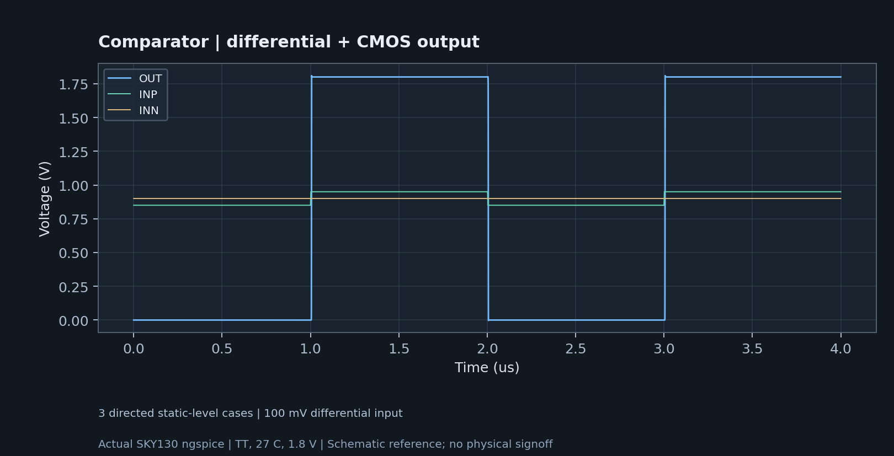

# 비교기 · 차동 입력 + CMOS 출력

정적 비교기 · 외부 바이어스 · hysteresis/offset/MC 미검증.

## 열고 재실행

Resistor 최신 소스의 프로젝트 도구 → 내 반도체에서 이 설계를 선택하거나 [프로젝트 ZIP](chip_comparator.register.zip)을 워크스페이스에서 가져옵니다. 회로도에서 하위 셀·MOS W/L·RC를 편집하고 Simulation을 실행하세요. 기존 0.16.1 설치본에는 새 template adapter가 없으므로 최신 소스 엔진이 필요합니다.

[회로 SPICE](core.spice) · [TT 결과](results-tt.json) · [실제 파형 CSV](waveforms.csv) · [실제 실행 manifest](native-manifest.json).

Docker의 SKY130 모델은 별도로 필요합니다. 폴더 전체를 유지하고 컨테이너에서 다음 testbench를 실행할 수 있습니다.

```sh
docker exec -w /workspace/examples/chip-portfolio/chip_comparator/spice mos-studio-eda /foss/tools/ngspice/bin/ngspice -b testbench.spice
```



## 실제 기본 관측값

TT · 27°C · 1.8V · TRAN · 3/3 파형 기준.

| 항목 | 실제 표본으로 계산한 값 |
|---|---|
| average_supply_power_W | 0.00003550328 |

## 포트폴리오 작성 순서

1. 요구 사양·입출력·전원·동작 영역과 이 외부 testbench 가정을 설명합니다.
2. 계층 회로·소자 크기·바이어스·보상 선택 이유를 보여줍니다.
3. 원본 파형과 표의 계산 방법을 제시하고 수정 전후를 비교합니다.
4. SS/TT/FF·온도·전원에서 목표가 충족되는지 확인합니다. 실패한 조건을 숨기지 않습니다.
5. 실제 소자 PCell, matching, guard ring, well tap, 배선·기생·DRC/LVS/PEX를 추가한 뒤 다시 검사합니다.

레이아웃은 미생성입니다. 이 ZIP의 빈 OASIS는 앱 교환 컨테이너이며 칩 레이아웃이 아닙니다. DRC/LVS/PEX·post-layout·Monte Carlo·잡음·칩 제조 signoff는 이번 참조에 포함하지 않습니다. 스위치드 커패시터 효율은 외부 클록 드라이버 전력을 제외한 power-stage 값입니다. PLL은 Type-I XOR, N=1이며 PFD/charge-pump 또는 RF jitter 검증이 아닙니다.
