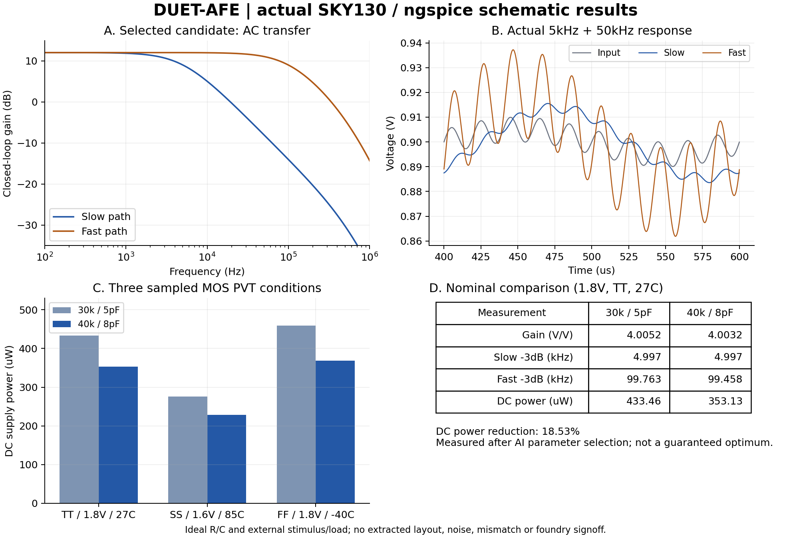
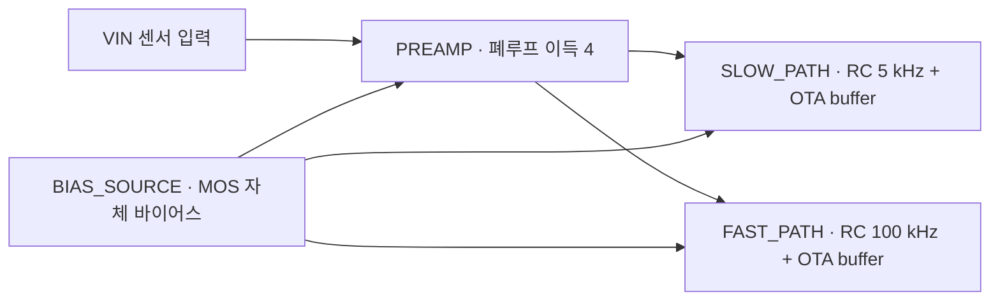

# DUET-AFE · 이중 대역 센서 프런트엔드

**Resistor Indust에서 직접 설계·편집·실행한 회로도 연구 예제**입니다. 센서 신호를 증폭한 뒤 느린 변화와 빠른 변화를 서로 다른 RC 대역으로 동시에 관찰합니다. 고정 구조의 바이어스·보상 값을 AI 오토 설계로 비교하고, 실제 ngspice 수치로 후보를 선택했습니다. 과학적 신규성·최첨단 성능·제조 완료를 주장하지 않습니다.



[PDF](measured-results.pdf) · [SVG](measured-results.svg) · [사용 가이드](../../docs/auto-design.md)

## 편집해서 사용하기

1. 최신 소스 앱의 **프로젝트 열기/가져오기**에서 [기본 DUET-AFE](DUET-AFE.register.zip) 또는 [AI 선택 후보 2](ai-candidates/candidate-2.register.zip)를 가져옵니다.
2. 회로도 계층에서 아래 네 루트 블록과 하위 OTA를 열어 연결·소자 값을 확인합니다. 가져오기는 새 프로젝트를 만들며 보관된 예제의 PASS/job을 새 설계의 검증으로 복사하지 않습니다.
3. 연결된 로컬 엔진에서 OP·AC·tran을 실제 실행합니다. 기본 과도 조건은 800µs/50ns이며 입력은 중간 전압에 5kHz와 50kHz, 각각 5mV를 더한 외부 자극입니다. 두 출력의 외부 부하는 각각 50fF입니다.
4. 파형에서 `VIN`, `PRE_OUT`, `SLOW`, `FAST`, `VCM`, `BIAS`, 공급 전류를 확인합니다. AC 자극은 1V의 소신호 정규화이며 실제 1V 대진폭 입력을 의미하지 않습니다.
5. 직접 생성하려면 **내 반도체 → DUET-AFE**를 사용하거나 **AI 오토 설계**에서 목표와 후보 수를 정하고 미리보기·실험을 승인합니다.

## 블록과 계산



| 블록 | 실제 하위 구성 | 역할 |
| --- | --- | --- |
| BIAS_SOURCE | SOC_BIAS | MOS 바이어스와 중간 전압 |
| PREAMP | DUET_GAIN → SOC_OTA | 비반전 증폭·피드백 |
| SLOW_PATH | DUET_SLOW → SOC_OTA | 저속 RC 극점·출력 버퍼 |
| FAST_PATH | DUET_FAST → SOC_OTA | 고속 RC 극점·출력 버퍼 |

공유 셀을 포함해 하위 셀 6종, 펼친 primitive 55개, net 28개입니다. 루트 포트는 `VIN PRE_OUT SLOW FAST VCM BIAS VPWR VGND`입니다. 이상적 피드백 이득은 `1 + R_FEEDBACK / R_GROUND`이며 300kΩ/100kΩ에서 4V/V입니다. RC 극점은 `f = 1 / (2πRC)`입니다. 100pF를 사용하면 5kHz에 318.309886kΩ, 100kHz에 15.915494kΩ입니다. 실제 MOS의 유한 이득과 대역폭 때문에 측정값은 이상식과 조금 다릅니다.

기본값은 바이어스 저항 30kΩ, 보상 C 5pF, nulling 저항 5kΩ입니다. 선택 후보는 바이어스 저항 **40kΩ**, 보상 C **8pF**이며 이득·RC 목표·nulling 저항은 같습니다. 회로 구조는 native 코드에서 결정하며 모델이 임의 코드를 실행하지 않습니다.

## 실제 측정값

2026-10-29, 공개 SKY130 1.8V MOS 모델·로컬 ngspice. OP 전력은 실제 공급 전류×전압이며 전체 transient 평균 전력이 아닙니다. 대역폭은 실제 AC 저주파 이득 대비 −3dB 지점을 보간했습니다.

| TT · 1.8V · 27°C | 기본/후보 1 | 선택 후보 2 |
| --- | ---: | ---: |
| 저속 저주파 이득 | 4.00524 V/V | 4.00325 V/V |
| 저속 −3dB 대역폭 | 4.99706 kHz | 4.99723 kHz |
| 고속 −3dB 대역폭 | 99.7628 kHz | 99.4577 kHz |
| 동작점 공급 전력 | 433.455 µW | 353.127 µW |

전력은 같은 TT 조건에서 **18.53% 감소**했습니다. 두 후보 중 측정된 선택 결과이며 전역 최적값을 보장하지 않습니다. 기본 과도 해석에서 50kHz 성분의 FAST/SLOW 출력 진폭 비는 약 8.991배였습니다. 측정은 적응형 시간 격자를 균일 재표본화한 뒤 DC·5kHz·50kHz 5항 최소제곱으로 분리하며 원본 파형도 제공합니다.

| 추가 MOS 조건 | 기본 전력 | 선택 후보 전력 | 선택 후보 저속/고속 BW | OP·AC·tran 지시 기준 |
| --- | ---: | ---: | --- | --- |
| SS · 1.6V · 85°C | 275.488 µW | 229.000 µW | 4.99660 / 98.2785 kHz | 3개 완료·충족 |
| FF · 1.8V · −40°C | 458.746 µW | 368.475 µW | 4.99741 / 99.3723 kHz | 3개 완료·충족 |

세 개의 결합 조건만 검사했으며 모든 전압/온도 조합의 sweep이 아닙니다. R/C는 이상적이며 조건 간 변하지 않습니다. 기준은 gain ±5%, 대역폭 목표 ±20%, 출력 rail 범위·5k/50kHz 신호 분리·잔차와 유한한 공급 전류 등 해당 예제의 지시 검사입니다. 전체 analog spec 인증이 아닙니다.

## 파일과 재현

- [기본 native preview](preview.json), [기본 flat SPICE](core.spice), [후보 1 SPICE](ai-candidates/candidate-1.spice), [후보 2 SPICE](ai-candidates/candidate-2.spice).
- 기본 TT 결과: [OP](op-result.json), [AC](ac-result.json), [tran](tran-result.json). 원본 `*-waveform.dat`, `*-manifest.json`도 이 폴더에 있습니다.
- 선택 후보 TT 원본: [AC](ai-candidates/selected-ac-waveform.dat), [tran](ai-candidates/selected-tran-waveform.dat).
- [기본 회로 9개 native 실행과 tool provenance](../../docs/evidence/duet-afe-20261029/native.json).
- [AI 2후보 6개 실행·추가 PVT 6개·ZIP 재가져오기](../../docs/evidence/auto-design-20261029/qualification.json).
- [실제 앱의 비교 화면](../../docs/evidence/auto-design-20261029/actual-comparison.png), [편집 가능한 생성 회로](../../docs/evidence/auto-design-20261029/generated-schematic.png).

저장된 manifest의 절대 경로는 원래 격리 실행의 provenance입니다. 다른 PC에서는 프로젝트를 가져와 다시 실행하세요. flat SPICE에는 외부 전원·모델 include·부하가 포함되지 않으며 native testbench가 붙입니다. 독립 실행하려면 공개 SKY130 모델 deck과 같은 조건의 testbench가 필요합니다.

```sh
node scripts/duet-afe-lab.mjs --generate
```

명령은 유료 API 없이 새 격리 작업공간에서 회로를 만들고 세 조건의 OP·AC·tran을 실행합니다. 그림은 `scripts/duet-afe-plots.py`로 생성하며 Matplotlib/NumPy는 그림 재생성용 선택 의존성입니다. 실제 회로 엔진의 측정에는 NumPy가 필요하지 않습니다.

## 참고와 남은 검증

다중 대역 센서 입력부의 응용 방향은 [SPAIC: A Precision Analog Interface for Event-based Sensors (2023)](https://arxiv.org/abs/2309.03221)에서 참고했습니다. 이 예제는 연속시간 두 RC 출력이며 논문의 event encoder·실리콘 회로·공정·성능을 재현한 것이 아닙니다. 회로의 OTA/바이어스는 저장소의 `analog_soc`/`chip_references`를 확장했습니다. 모델 정의는 [공식 SKY130 device details](https://skywater-pdk.readthedocs.io/en/main/rules/device-details.html)를 따릅니다.

레이아웃은 생성하지 않았습니다. 300×300µm envelope는 입력 제한이며 실제 소자 면적이 아닙니다. 임포트 뒤 DRC/LVS/PEX 요청은 `NO_PHYSICAL_LAYOUT`으로 차단되는 것을 실제 확인했습니다. 잡음, offset/mismatch, 저항·커패시터 공정 편차, CMRR/PSRR, 입력/출력 전체 동작 범위, 안정성의 전체 부하 sweep, PEX·제조 signoff는 미검증입니다. 다음 설계에서는 특히 큰 RC의 실면적·잡음·공정 편차와 낮아진 바이어스의 안정성 tradeoff를 검토해야 합니다.
