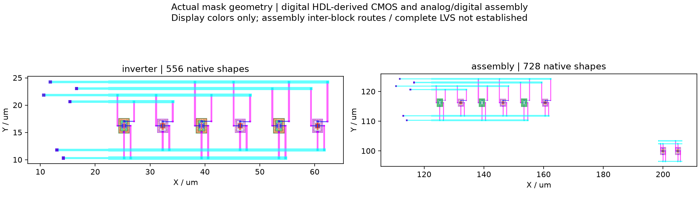

# Resistor Indust · Hardware source and mixed-signal lab

[사용 가이드](../../docs/hardware-workbench.md) · [실제 실행 기록](qualification.json) · [전기적 수치 대조](mixed-electrical-check.json) · [파일 해시](SHA256SUMS.json)

Verilog/SystemVerilog, VHDL, 제한된 uint32 C, RTLIL/BLIF와 flat SPICE의 실제 처리 예제입니다. 원본 HDL·테스트 벡터·생성 회로·실제 geometry를 register.zip으로 보존합니다. 애플리케이션 installer가 아닙니다.

## 편집 프로젝트

| 설계 | 파일 | source revision |
|---|---|---|
| inverter | [register.zip](projects/inverter/inverter.register.zip) | r3 |
| adder | [register.zip](projects/adder/adder.register.zip) | r2 |
| counter | [register.zip](projects/counter/counter.register.zip) | r2 |
| vhdl | [register.zip](projects/vhdl/vhdl.register.zip) | r2 |
| c | [register.zip](projects/c/c.register.zip) | r2 |
| blif | [register.zip](projects/blif/blif.register.zip) | r2 |
| rtlil | [register.zip](projects/rtlil/rtlil.register.zip) | r2 |
| rom | [register.zip](projects/rom/rom.register.zip) | r2 |
| mixed-language | [register.zip](projects/mixed-language/mixed-language.register.zip) | r2 |
| spice | [register.zip](projects/spice/spice.register.zip) | r2 |
| analog | [register.zip](projects/analog/analog.register.zip) | r2 |
| imported | [register.zip](projects/imported/imported.register.zip) | r1 |
| assembly | [register.zip](projects/assembly/assembly.register.zip) | r4 |
| analog_macro | [register.zip](projects/analog_macro/analog_macro.register.zip) | r1 |

가져온 ZIP은 새 프로젝트로 열며 과거 PASS를 상속하지 않습니다. assembly는 실제 HDL-derived digital CMOS와 analog current mirror를 포함합니다. block 간 논리 pin mapping과 mask 배치를 보존하지만 block 사이의 물리 배선·전체 LVS/PEX는 미완료입니다.

## 실제 실행

| 검사 | 실행 | 분석 | 현재 revision/source에 대한 상태 | 원본 |
|---|---|---|---|---|
| inverter-simulate | completed | pass | stale | [27821fd1](runs/27821fd1fd9042e2aba4b5a303701b05/run-snapshot.json) |
| adder-simulate | completed | pass | current | [fa2b7f2c](runs/fa2b7f2ca32e41ab8b2aa507917b6f54/run-snapshot.json) |
| adder-synthesize | completed | unknown | current | [bd03fa16](runs/bd03fa165349484498247e73a99c9347/run-snapshot.json) |
| counter-simulate | completed | pass | current | [f1fc7024](runs/f1fc70244407473eb0de608bf5487abd/run-snapshot.json) |
| counter-synthesize | completed | unknown | current | [5846d677](runs/5846d677e08c4dec907a35f526421025/run-snapshot.json) |
| vhdl-simulate | completed | pass | current | [9f00fc5d](runs/9f00fc5dab2a4a16afc7d24c220e4dcd/run-snapshot.json) |
| vhdl-synthesize | completed | unknown | current | [adaf9872](runs/adaf987268c7468c8f52155cafe405fb/run-snapshot.json) |
| c-simulate | completed | pass | current | [5d84feab](runs/5d84feab86ba4ce49c3ad458d7250454/run-snapshot.json) |
| c-synthesize | completed | unknown | current | [c3213ee0](runs/c3213ee0f2664595a77040b74fb4c0ba/run-snapshot.json) |
| blif-simulate | completed | pass | current | [13b1fa81](runs/13b1fa8117fb437baa7e48d7d38e9c4d/run-snapshot.json) |
| rtlil-simulate | completed | pass | current | [f1a04bf0](runs/f1a04bf0f7524b6bb2e6701b27cb30d4/run-snapshot.json) |
| rom-simulate | completed | pass | current | [6abb0128](runs/6abb0128e5c940c48d8fd1c125433e94/run-snapshot.json) |
| mixed-language-simulate | completed | pass | current | [ce7c51de](runs/ce7c51de6e6146fda8446b3f39da8b5f/run-snapshot.json) |
| spice-import | completed | unknown | current | [32a0d5b4](runs/32a0d5b45d5947ad8754429b7ba762a3/run-snapshot.json) |
| inverter-physical | completed | unknown | stale | [60e367b9](runs/60e367b98eb74b608d05dccf987d2c0b/run-snapshot.json) |
| hdl-drc | completed | pass | current | [3dcd8d4e](runs/3dcd8d4ed9084655af8cf34961ba5f7d/run-snapshot.json) |
| hdl-lvs | completed | pass | current | [71b00ffc](runs/71b00ffcc1034ee19243ccc72a7b1f7b/run-snapshot.json) |
| mixed-mos-rc | completed | unknown | current | [9127f180](runs/9127f1804ff64f8f83d3f671cc12e156/run-snapshot.json) |
| negative-wrong-output | failed | unknown | current | [fcc31027](runs/fcc3102707764a82a553f10a34626e18/run-snapshot.json) |
| historical-rc-step-rejected | failed | unknown | stale | [b98695f5](runs/b98695f5453644d294bedcdf4df8596c/run-snapshot.json) |
| historical-ui-physical-flow | completed | unknown | stale | [b4463674](runs/b44636740455455187879a4627b64245/run-snapshot.json) |
| ui-c-simulate | completed | pass | current | [7c0a9805](runs/7c0a9805df224ae89bd2093dbe44ff70/run-snapshot.json) |

독립된 9개 디지털 벡터 설계에서 **665개 output assertions**를 실제 검사했습니다. C의 68개 입력은 GCC가 독립적으로 컴파일·계산한 값과 Icarus 결과를 비교했습니다. VHDL은 GHDL 합성 후 생성 Verilog를 검사한 범위이며, 모든 VHDL behavioral semantics나 전체 SV/UVM 지원을 뜻하지 않습니다.

소형 HDL-derived CMOS의 실제 Magic DRC는 0건, Netgen LVS는 일치했습니다. 이 검증을 assembly 전체에 적용하지 않습니다. 합성·도형 생성 완료는 `unknown`으로 유지하며, 미실행 DRC/LVS/PEX를 PASS로 표시하지 않습니다. 소스/회로를 적용한 다음에는 과거 revision의 실행이 STALE인 것이 정상입니다.

실제 ngspice mixed MOS+ideal RC 해석의 4,550개 표본·11개 signed current branches를 보존했습니다. I_R=(V_y−V_ANALOG_OUT)/R 및 외부 RC node KCL을 수치 대조하고 8개 late-settle 입력/출력을 확인했습니다. MOS driver가 포함된 전체 응답을 외부 R×C와 같다고 가정하지 않습니다. 수치 비교 결과는 mixed-electrical-check.json을 확인하세요. Native run의 reference criteria가 비어 있는 `unknown` 상태는 덮어쓰지 않습니다.

실패한 기대 출력과 과거 source transition/step 오류도 남깁니다. 로그·생성 netlist·실제 VCD/파형과 원래 manifest를 보존합니다. 실행 바이너리·compiler cache·worker 설정·키는 제외합니다. 일부 대용량 텍스트/raw는 lossless gzip이고, qualification.json의 original_sha256 및 바이트 수로 원본을 확인할 수 있습니다. runs/에는 이전 isolated iteration도 남아 있으며 최신 선택 목록은 qualification.json입니다. 제조 signoff·전체 PVT/타이밍·새 installer 출시는 미완료입니다.
