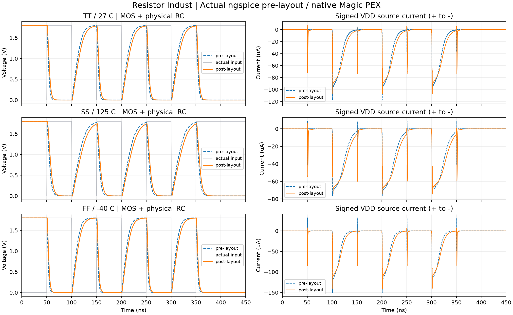

# Resistor Indust · Hardware validation

[검증 가이드](../../docs/hardware-validation.md) · [전체 실행](qualification.json) · [전기적 대조](electrical-validation.json)

실제 원본 입력·VCD·GDS/OASIS·SPICE·tool log와 편집 설계입니다. ZIP 가져오기는 과거 PASS를 상속하지 않습니다.

## 편집 프로젝트

- [routed_rc](projects/routed_rc/routed_rc.register.zip) · logic_inv r2
- [routed_analog_digital](projects/routed_analog_digital/routed_analog_digital.register.zip) · SOC_TOP r8
- [physical_adder4](projects/physical_adder4/physical_adder4.register.zip) · adder4 r2
- [physical_counter4](projects/physical_counter4/physical_counter4.register.zip) · counter4 r2
- [wide64](projects/wide64/wide64.register.zip) · schematic r2
- [signed8](projects/signed8/signed8.register.zip) · schematic r2
- [c_math](projects/c_math/c_math.register.zip) · schematic r2

## 실제 상태

| 범위 | 실행 | 분석 | freshness | 근거 |
|---|---|---|---|---|
| core/inverter-simulate | completed | pass | stale | [native files](runs/b5403c7518aa47c096bad78d9081724c/manifest.json) |
| core/adder-simulate | completed | pass | current | [native files](runs/02118456cf544036b1d520d329a93df8/manifest.json) |
| core/adder-synthesize | completed | unknown | current | [native files](runs/6b5a6004e5a54b49b06675456c5d0e3b/manifest.json) |
| core/counter-simulate | completed | pass | current | [native files](runs/4710e25c269c4445a4c63f923c37429b/manifest.json) |
| core/counter-synthesize | completed | unknown | current | [native files](runs/66b20e8fc7f14ec08562070175c74217/manifest.json) |
| core/vhdl-simulate | completed | pass | current | [native files](runs/18c8acacb19f46f59627de5976d0f28d/manifest.json) |
| core/vhdl-synthesize | completed | unknown | current | [native files](runs/3d834bd7334f40fea61fcc734dbc3f08/manifest.json) |
| core/c-simulate | completed | pass | current | [native files](runs/0ab3859fb86b4fabbb80936fd54ca0f3/manifest.json) |
| core/c-synthesize | completed | unknown | current | [native files](runs/77f9ff9ab62249708ddc8a59df001b43/manifest.json) |
| core/blif-simulate | completed | pass | current | [native files](runs/e924957001784ad2aa16ee7d8ce11271/manifest.json) |
| core/rtlil-simulate | completed | pass | current | [native files](runs/15e8fa73e29a49e39e8452ae919c330f/manifest.json) |
| core/rom-simulate | completed | pass | current | [native files](runs/5fe4748efd914bcaad3068f76e91b7dc/manifest.json) |
| core/mixed-language-simulate | completed | pass | current | [native files](runs/a7fd15fc97434f48a0f78dc1d7a0f645/manifest.json) |
| core/spice-import | completed | unknown | current | [native files](runs/a6da8feae4714890b86a1de0fa7298d7/manifest.json) |
| core/inverter-physical | completed | unknown | stale | [native files](runs/5a3f23536f20418784cd891bcbac7254/manifest.json) |
| core/hdl-drc | completed | pass | current | [native files](runs/4513e87b023843f4a46e9d492ae857ba/manifest.json) |
| core/hdl-lvs | completed | pass | current | [native files](runs/90728e02aabc41228aae7275eda27bd6/manifest.json) |
| core/mixed-mos-rc | completed | unknown | current | [native files](runs/f3de7c5aee52488aa4063b1eaca5a687/manifest.json) |
| core/negative-wrong-output | failed | unknown | current | [native files](runs/e7744cd150714ca9ac8ce6583ef8cd77/manifest.json) |
| edge/wide64 | completed | pass | current | [native files](runs/db052a1a2af348a5b1155586014235d0/manifest.json) |
| edge/ascending-offset | completed | pass | current | [native files](runs/a6908ee656cb4330a9e8677e79241adf/manifest.json) |
| edge/signed8 | completed | pass | current | [native files](runs/c520be8ea03f4b5c83b068e3c64ff135/manifest.json) |
| edge/c-math-oracle | completed | pass | current | [native files](runs/5b62cc4a1d464473b436b649490f0dcc/manifest.json) |
| edge/no-expectation-is-unknown | completed | unknown | current | [native files](runs/cd63164ec2e0463a910c0aa3ef482be9/manifest.json) |
| edge/x-never-passes | failed | unknown | current | [native files](runs/d886985481834afebdf9fc730695f217/manifest.json) |
| edge/compile-error-retained | failed | unknown | current | [native files](runs/0b17e33251ca4fdd94ed1125e0cec749/manifest.json) |
| edge/input-overflow-rejected | failed | unknown | current | [native files](runs/059e978aba2f4c5680357a1bc113c43e/manifest.json) |
| routed/assembly-route | completed | unknown | stale | [native files](runs/49e93b9db5cd478f917846c487238738/manifest.json) |
| routed/assembly-drc | completed | pass | current | [native files](runs/2b13b9f1a1e14046b5ea3addc2e4092f/manifest.json) |
| routed/assembly-lvs | completed | pass | current | [native files](runs/8092d45602684deb82af7b07cf4e61ea/manifest.json) |
| routed/assembly-pex | completed | pass | current | [native files](runs/6537b53d64ee4e21bc7aab01badc0683/manifest.json) |
| routed/assembly-post-dc | completed | pass | current | [native files](runs/7cd482c77cd44aef94754ef16a55d642/manifest.json.gz) |
| routed/analog-route | completed | unknown | stale | [native files](runs/08f33accd07241e4989f85e3d637540c/manifest.json) |
| routed/analog-drc | completed | pass | current | [native files](runs/e914d07ab0c14253b37549f925b54277/manifest.json) |
| routed/analog-lvs | completed | pass | current | [native files](runs/5a72c0b1b80f445184329e8a90dddb16/manifest.json) |
| routed/analog-pex | completed | pass | current | [native files](runs/c06019b8f0154bce9e321098bc625fc4/manifest.json) |
| routed/analog-tt-pre | completed | unknown | current | [native files](runs/a7684f809db54f649367c91ddf4e5bc1/manifest.json) |
| routed/analog-tt-post | completed | unknown | current | [native files](runs/2bf00be776b44f99b1c144967de39f10/manifest.json) |
| routed/analog-ss-pre | completed | unknown | current | [native files](runs/164dd8b0d2a64fe2b7596f9d10c54f31/manifest.json) |
| routed/analog-ss-post | completed | unknown | current | [native files](runs/0f73dbdddc4a4901ac6427d34ec31287/manifest.json) |
| routed/analog-ff-pre | completed | unknown | current | [native files](runs/1a7402cd0fb84081b91231aae6eb4f5a/manifest.json) |
| routed/analog-ff-post | completed | unknown | current | [native files](runs/13787f421384482898c74823bd67c3ed/manifest.json) |
| digital-physical/adder-physical | completed | unknown | stale | [native files](runs/76a46e86322d4dea94e01e32eb56ec0d/manifest.json) |
| digital-physical/adder-drc | completed | pass | current | [native files](runs/773e27fe264f47139b4ede80869494f8/manifest.json) |
| digital-physical/adder-lvs | completed | pass | current | [native files](runs/3b7feaea6e3b4bd1bd883829d6e34847/manifest.json) |
| digital-physical/adder-pex | completed | pass | current | [native files](runs/7d606786daed452aac3e7c3711dba1dd/manifest.json) |
| digital-physical/counter-physical | completed | unknown | stale | [native files](runs/ddb8657111fd4918966dac2f5772ff80/manifest.json) |
| digital-physical/counter-drc | completed | pass | current | [native files](runs/bb8f26710f6140f984bb3bbdcd99fd91/manifest.json) |
| digital-physical/counter-lvs | completed | pass | current | [native files](runs/c9004ee395154ac99bf96bc1cc7679d6/manifest.json) |
| digital-physical/counter-pex | completed | pass | current | [native files](runs/f8184c1c9d574f30bea29d524de7293f/manifest.json) |
| digital-physical/c-physical | failed | unknown | current | [native files](runs/633d57db6a064b96ae5138bbad1266dc/manifest.json) |
| inverter-pex | completed | pass | current | [native files](runs/503c37fb08ba45ed88bfa0c89c815efd/manifest.json) |
| ui/c-simulate | completed | pass | current | [native files](runs/5e518fd609ba49e3b9b6c09cba36977e/manifest.json) |

기대값 불일치·X·입력 overflow·compile 오류·512소자 한도는 의도적으로 실패시킨 회귀 항목입니다. 합성/preview 완료와 기준 없는 transient는 unknown을 유지합니다.

## 보존한 이전 오류

- historical/unrouted-lvs: completed/fail. [원본](runs/0b5e031606114e9a9a624cb750d53b0c/manifest.json) · Actual Netgen comparison: connectivity or property mismatch; inspect native report.
- historical/wrong-port-order: completed/unknown. [원본](runs/66301f4fe8df4ec781c4a7c54657c9d6/manifest.json) · Actual ngspice tran: 4550 samples.; reference criteria 0/0

역사적 실행은 그때의 adapter source hash를 유지합니다. 현재 qualification과 혼합하지 않습니다.

큰 중복 simulator .raw는 로컬에 보존하고 원본 waveform/current .dat와 실제 run 수치를 제공합니다. project-input은 이전 run 이력만 제외한 파생 snapshot이며 원본 hash와 생략 내역을 qualification에 표시합니다.
