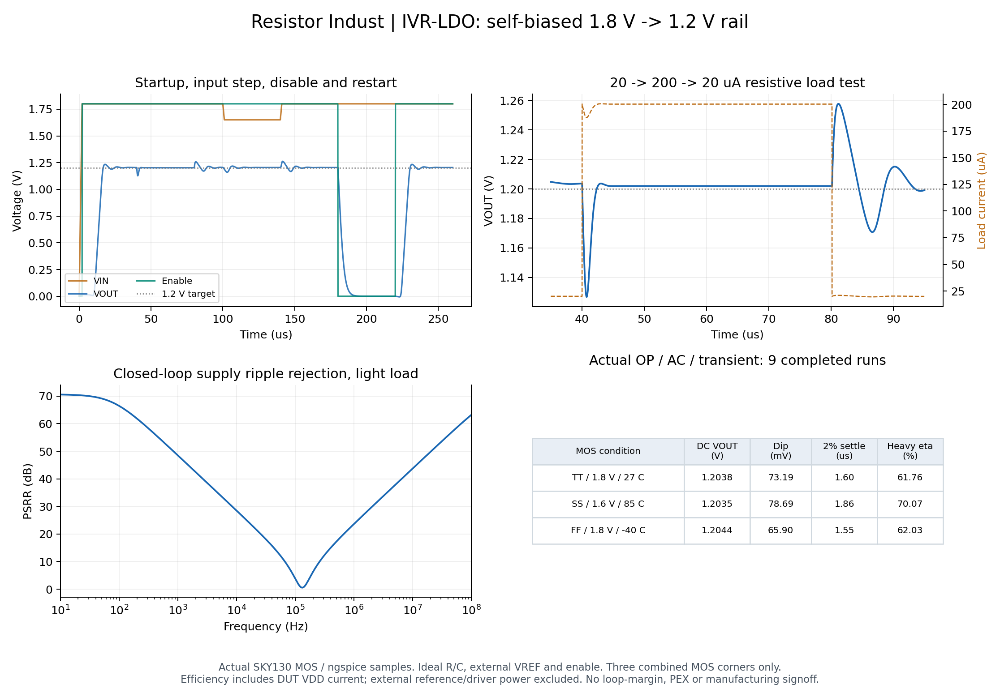
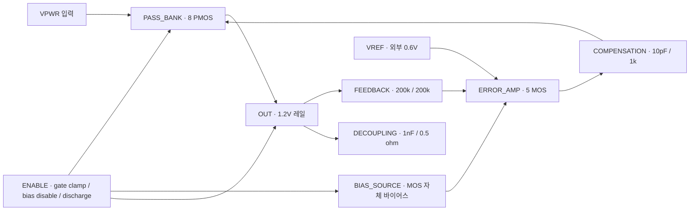

# IVR-LDO · 1.2V 온칩 전원 레일

Resistor Indust에서 편집하고 실제 SKY130 MOS 모델로 실행하는 **Integrated Voltage Regulator의 선형 LDO 예제**입니다. 외부 1.6–1.8V 공급과 0.6V 기준에서 1.2V 레일을 만들며 자체 바이어스, 병렬 PMOS, Enable/출력 방전을 포함합니다.

[편집 프로젝트 ZIP](IVR-LDO.register.zip) · [flat SPICE](core.spice) · [측정 PDF](measured-results.pdf) · [SVG](measured-results.svg)



## 앱에서 실행하기

1. 최신 소스 앱의 **프로젝트 열기/가져오기**에서 `IVR-LDO.register.zip`을 가져옵니다. 새 프로젝트이며 보관된 실행의 PASS를 가져온 설계에 복사하지 않습니다.
2. 또는 **프로젝트 도구 → 내 반도체**에서 **IVR · 1.8V → 1.2V 자체 바이어스 온칩 LDO**를 생성합니다. native ID는 `soc_ivr_ldo`입니다. physical core는 지원하지 않습니다.
3. 루트의 7개 블록을 더블 클릭해 소자와 연결을 수정합니다. `PASS_BANK`에는 W/L=20/0.15µm PMOS가 8개 있습니다. 연결은 명시적 pin/net이며 화면 점선은 배선 마스크가 아닙니다.
4. **시뮬레이션**에서 OP, AC, tran을 실행합니다. 기본 과도 해석은 260µs / 50ns입니다. 최소 260µs·최대 100ns step보다 짧거나 거친 설정은 완료로 표시하지 않고 거절합니다.
5. **IVR · 실제 전원 레일 측정**, 전압·부호 있는 전류·전압 강하 표와 파형을 확인합니다. PSRR 최소값도 확인하세요. 100Hz 한 지점의 기준 충족은 전 대역 성능이나 위상 여유의 인증이 아닙니다.

**AI 오토 설계**에도 IVR을 연결했습니다. 외부 기준 0.6V, 목표 1.2V, 시험 부하 20→200µA를 고정하고 패스 뱅크·바이어스·보상·출력 R/C 후보를 비교합니다. 모델이 시험 부하나 목표 레일을 바꾸면 거절합니다. 이번 IVR 작업에서는 유료 모델을 호출하지 않았으며 제공자 경로는 테스트 응답으로 검사했습니다. 실제 MOS 해석과 구분합니다.

## 회로 구성



| 하위 셀 | 구성·역할 |
| --- | --- |
| IVR_BIAS | 100kΩ 공급 저항, 기준 NMOS, disable clamp |
| IVR_ERROR_AMP | 5-MOS 차동 입력/전류 미러 부하 오차 증폭기 |
| IVR_PASS_BANK | W/L=20/0.15µm PMOS ×8, 총 W=160µm |
| IVR_FEEDBACK | 200kΩ/200kΩ 출력 감지 |
| IVR_COMPENSATION | 1kΩ gate isolation, 10pF Miller, 1kΩ nulling |
| IVR_ENABLE | CMOS 반전기, PMOS gate-off clamp, NMOS 출력 방전 |
| IVR_DECOUPLING | 이상적 1nF 출력 C와 0.5Ω ESR |

하위 셀 7개, 펼친 primitive 27개(19 MOS·6 R·2 C)입니다. 포트는 `VREF EN OUT FB GATE BIAS VPWR VGND`입니다. 출력 목표는 `VOUT = VREF × (1 + R_TOP/R_BOTTOM)`이며 실제 증폭기의 유한 이득 때문에 DC 오차가 남습니다. 소프트스타트는 **외부 VREF의 2–7µs 램프**가 제공합니다. 내부 bandgap/기준 발생기나 소프트스타트 제어기는 포함하지 않습니다.

## 실제 시험과 수치

| 시간 | 외부 자극 |
| --- | --- |
| 0–2µs | 입력 공급 0→선택 공급 전압 |
| 2–2.1µs / 2–7µs | Enable 켜짐 / VREF 0→0.6V 램프 |
| 약 40µs / 80µs | 20→200→20µA 명목 저항 부하 |
| 100–101µs / 140–141µs | 입력 1.8→1.65→1.8V; SS 1.6V 조건에서는 1.6→1.5→1.6V |
| 180–180.1µs / 220–220.1µs | Enable 꺼짐·출력 방전 / 다시 켜짐 |

부하는 이상적 정전류 sink가 아닌 저항이며 1.2V에서 20/200µA가 되도록 설정합니다. 실제 전류는 VOUT에 따라 변하며 원본 파형에 기록됩니다. 부하 switch/control, 공급, 기준과 Enable은 외부 시험 회로입니다.

2026-10-31 공개 SKY130 모델·ngspice 47에서 각 조건의 OP·AC·tran을 실제 실행했습니다.

| 결합 MOS 조건 | DC 출력 | 부하 제외 VDD 전류 | 부하 증가 하강 | ±2% 복구 | 큰 부하 효율 |
| --- | ---: | ---: | ---: | ---: | ---: |
| TT · 1.8V · 27°C | 1.203812V | 16.278µA | 73.190mV | 1.604µs | 61.765% |
| SS · 1.6V · 85°C | 1.203470V | 14.357µA | 78.691mV | 1.857µs | 70.066% |
| FF · 1.8V · −40°C | 1.204352V | 15.531µA | 65.899mV | 1.554µs | 62.025% |

복구 시간은 40.1µs 이후 마지막 허용 범위 이탈 다음 표본까지의 경계값입니다. nominal 기동은 기준 램프가 끝난 7µs 이후 약 12.225µs에 ±2% 범위에 정착했습니다. nominal 부하 해제 overshoot는 57.730mV, 꺼짐 구간 최대 출력은 약 62.981µV입니다.

효율은 큰 부하의 65–75µs에서 실제 `VOUT(t)·ILOAD(t)` / `VIN(t)·IIN(t)`의 적분 비입니다. bias·피드백·Enable의 DUT VDD 전류를 포함하며 외부 기준/제어 드라이버 전력은 제외합니다. `dropout_headroom_V`는 **현재 입력−출력 전압차**이며 최소 dropout 스펙을 측정한 값이 아닙니다.

## 확인한 한계

- nominal 100Hz PSRR는 66.43dB지만 **약 129.57kHz에서 최소 0.558dB**까지 낮아집니다. 고주파 리플 억제 개선이 필요합니다. AC는 light-load 공급 리플 전달 해석이며 위상 여유·return ratio·전체 부하 안정성은 미검증입니다.
- MOS TT/SS/FF 세 결합 조건만 검사했습니다. 전 온도·전압 조합 sweep, 실제 R/C 공정 변화와 소자 편차/수율은 미검증입니다.
- 기준 전압은 외부 이상적 입력입니다. 잡음·bandgap·전류 제한·역전류 차단·열 보호·ESD·패드/패키지·EM/IR은 검증하지 않았습니다.
- 출력 C는 회로 내부의 이상적 소자입니다. 1nF의 실면적·공정 편차·기생은 별도 물리 설계가 필요합니다. 저장한 1000×1000µm 제약은 측정 면적이 아닙니다. 레이아웃이 비어 있어 DRC/LVS/PEX 요청이 `NO_PHYSICAL_LAYOUT`으로 차단되는 것을 확인했습니다.
- 초기 20pF 보상에서는 기동 관측 구간을 놓쳤고 10pF로 조정해 위 기준을 충족했습니다. 추가 gate-supply 커패시터 실험은 기동/과도 응답과의 절충이 커 기본 회로에 채택하지 않았습니다.

## 원본·재현·참고 자료

[최종 검사 요약](../../docs/evidence/ivr-20261031/verification.json), [실제 9개 실행·PDK/tool provenance·재가져오기](../../docs/evidence/ivr-20261031/native.json), [현재 판정 로직으로 원본 표본을 다시 검사한 기록](../../docs/evidence/ivr-20261031/criteria-audit.json), [앱에서 생성·실행한 화면](../../docs/evidence/ivr-20261031/actual-ivr-metrics.png), `op/ac/tran-result.json`, `*-waveform.dat`, `*-manifest.json`, `*-testbench.spice`를 제공합니다. manifest/testbench의 절대 경로는 원래 격리 실행 기록입니다. 다른 PC에서는 ZIP을 가져와 다시 실행하세요. `core.spice`에는 외부 전원·모델 include·자극/부하가 포함되지 않습니다.

```sh
node scripts/ivr-lab.mjs --generate
python scripts/ivr-audit.py
```

유료 API 없이 새 격리 작업공간에서 preview→hash-bound 생성→9개 실제 해석→ZIP 재가져오기와 물리 검사 차단을 재현합니다. Python·KLayout·ngspice·공개 SKY130 모델이 필요합니다. `scripts/ivr-plots.py`의 Matplotlib/NumPy는 그림 재생성용 선택 의존성이며 실제 엔진에는 필요하지 않습니다.

구성과 검증 방향은 [Analog Devices의 LDO 구조·과도 응답 설명](https://www.analog.com/en/resources/analog-dialogue/articles/applying-low-dropout-regulators.html), [TI SLVA115A의 PMOS LDO pole·ESR·load transient 설명](https://www.ti.com/lit/an/slva115a/slva115a.pdf)을 참고했습니다. 공정 소자는 [공식 SKY130 device details](https://skywater-pdk.readthedocs.io/en/main/rules/device-details.html)에 따릅니다. 상용 회로·실리콘 성능을 재현한 것이 아니며 저장소의 자체 MOS 블록을 확장했습니다.
