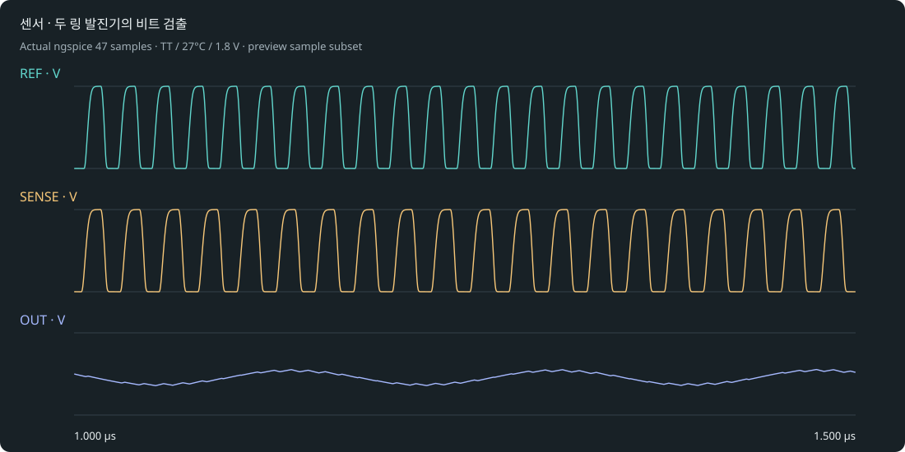

# 센서 · 두 링 발진기의 비트 검출

Resistor Indust · 빠른 두 발진기의 차이를 더 느린 비트 파형으로 읽기.

독립 5단 링 2개 + 실제 CMOS XOR + 이상적 RC · Δf 읽기. 회로 구조: REFERENCE_RING + SENSOR_RING → CMOS XOR → RC → OUT.

## 실행

최신 소스 엔진에서 프로젝트 도구 → 내 반도체 → 발진기·센서 프로젝트를 선택하거나 [프로젝트 ZIP](osc_beat.register.zip)을 가져옵니다. 공개 0.28 설치본에는 새 template adapter가 포함되지 않았습니다.

1. REF와 SENSE가 외부 클록 없이 독립적으로 발진하는지 확인합니다.
2. XOR와 저역통과 OUT을 함께 읽고 주파수 차와 관측 비트 주파수를 대조합니다.
3. SENSOR 링의 C 증가율을 5~30% 범위에서 바꾸어 봅니다. 차이가 너무 작거나 필터가 부적절하면 관측 시간·필터를 조정하고 실패 항목을 읽습니다.

## 실제 기본 결과

TT/27°C/1.8V: 5.89912e+6 Hz · 0.00306671 W.

fbeat ≈ |fREF − fSENSE|. OUT은 XOR 듀티를 RC로 평균한 파형입니다. 실제 출력의 반복 주기와 독립 링들의 주파수 차를 비교합니다.

[실제 파형](waveform.svg) · [전체 표본](waveform.dat) · [측정과 파형 기준](result-tt.json) · [실행 manifest](manifest.json) · [회로](core.spice).

실제 MOS 해석과 이상적 외부 R/C입니다. 초기 조건을 명시했습니다. 레이아웃은 비어 있으며 DRC/LVS/PEX·위상 잡음·지터·센서 보정·제조 signoff는 미검증입니다. 참조값은 부품 오차나 실물 성능 보증이 아닙니다.
