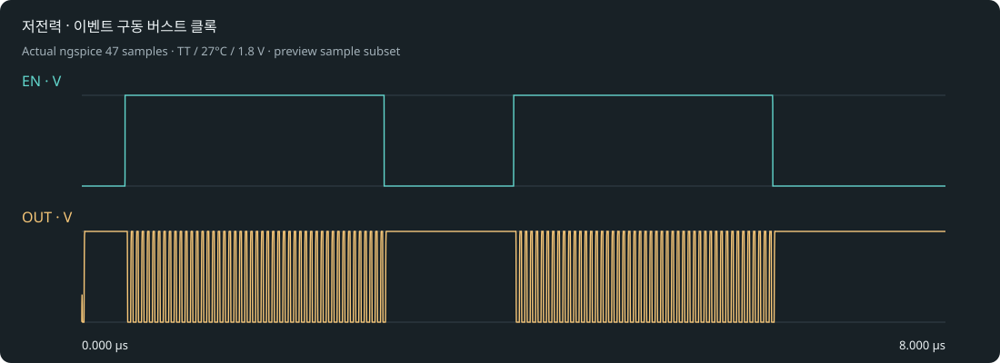

# 저전력 · 이벤트 구동 버스트 클록

Resistor Indust · 이벤트가 있을 때만 동작하는 웨이크업 클록.

NAND + 인버터 4단 링 · 외부 EN 2개 구간 · 발진 출력은 실제 MOS 해석. 회로 구조: 외부 EN → NAND + 인버터 4단 링 → OUT.

## 실행

최신 소스 엔진에서 프로젝트 도구 → 내 반도체 → 발진기·센서 프로젝트를 선택하거나 [프로젝트 ZIP](osc_burst.register.zip)을 가져옵니다. 공개 0.28 설치본에는 새 template adapter가 포함되지 않았습니다.

1. EN·OUT을 겹쳐 두 번의 시작·정지 구간을 확인합니다.
2. EN=LOW에서 OUT이 HIGH로 정지하는지, 두 번째 EN에서도 다시 발진하는지 확인합니다.
3. 실행 결과의 구간별 공급 전력을 비교합니다. 전력 절감 비율은 실제 조건의 측정으로 판단하고 누설·부하·EN 구동 전력 범위를 명시합니다.

## 실제 기본 결과

TT/27°C/1.8V: 1.98763e+7 Hz · 0.000308820 W.

Pavg = VDD × ∫ I(VDD) dt / Δt. EN 입력의 외부 드라이버 전력은 포함하지 않습니다.

[실제 파형](waveform.svg) · [전체 표본](waveform.dat) · [측정과 파형 기준](result-tt.json) · [실행 manifest](manifest.json) · [회로](core.spice).

실제 MOS 해석과 이상적 외부 R/C입니다. 초기 조건을 명시했습니다. 레이아웃은 비어 있으며 DRC/LVS/PEX·위상 잡음·지터·센서 보정·제조 signoff는 미검증입니다. 참조값은 부품 오차나 실물 성능 보증이 아닙니다.
