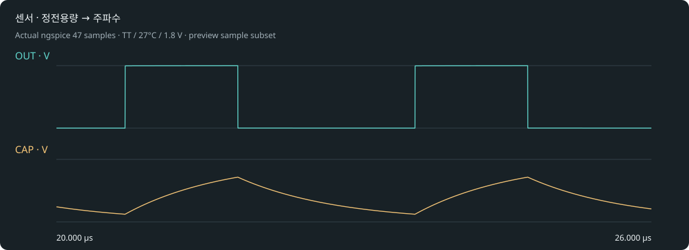

# 센서 · 정전용량 → 주파수

Resistor Indust · 정전용량 변화를 주파수로 바꾸는 터치·근접 센서의 출발점.

6개 실제 MOS + 저항 양의 피드백 · 이상적 센서 C · 외부 클록 없음. 회로 구조: OUT → R_TIMING → CAP → 저항 피드백 인버터 → OUT.

## 실행

최신 소스 엔진에서 프로젝트 도구 → 내 반도체 → 발진기·센서 프로젝트를 선택하거나 [프로젝트 ZIP](osc_rc_sensor.register.zip)을 가져옵니다. 공개 0.28 설치본에는 새 template adapter가 포함되지 않았습니다.

1. OUT과 CAP을 겹쳐 커패시터 충·방전 및 실제 전환 전압을 확인합니다.
2. 동일 R에서 C=5pF·10pF·20pF로 세 프로젝트를 만들고 주파수를 비교합니다.
3. 전환 전압으로 계산한 이상적 RC 기준과 MOS 해석의 차이를 설명합니다. 실제 손가락·전극 모델과 보정은 추가해야 합니다.

## 실제 기본 결과

TT/27°C/1.8V: 342116 Hz · 0.0000369073 W.

Tideal = RC { ln[(VHIGH−VL)/(VHIGH−VH)] + ln[(VH−VLOW)/(VL−VLOW)] }. 실제 전환 전압을 사용하되 피드백 부하·MOS 지연·기생 성분은 포함하지 않은 비교식입니다.

[실제 파형](waveform.svg) · [전체 표본](waveform.dat) · [측정과 파형 기준](result-tt.json) · [실행 manifest](manifest.json) · [회로](core.spice).

실제 MOS 해석과 이상적 외부 R/C입니다. 초기 조건을 명시했습니다. 레이아웃은 비어 있으며 DRC/LVS/PEX·위상 잡음·지터·센서 보정·제조 signoff는 미검증입니다. 참조값은 부품 오차나 실물 성능 보증이 아닙니다.
