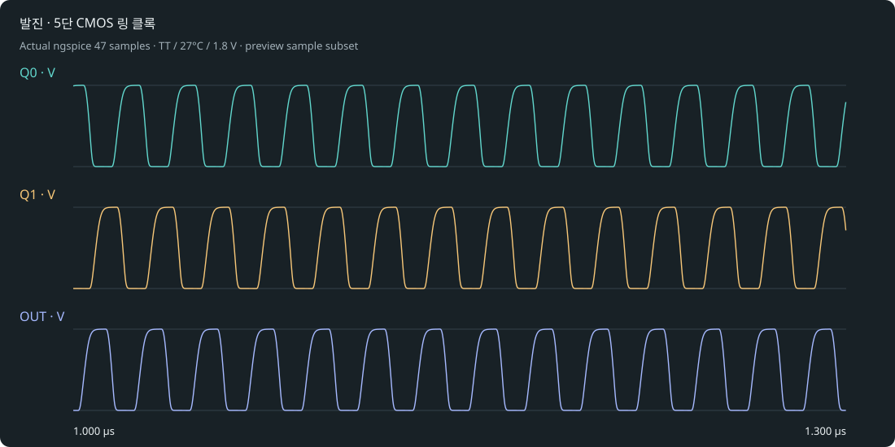

# 발진 · 5단 CMOS 링 클록

Resistor Indust · 부하가 클록을 얼마나 늦추는지 살펴보기.

10개 실제 SKY130 MOS · 5단 지연 링 · 외부 클록 없음 · 이상적 단계 부하. 회로 구조: Q0 → Q1 → Q2 → Q3 → OUT → Q0.

## 실행

최신 소스 엔진에서 프로젝트 도구 → 내 반도체 → 발진기·센서 프로젝트를 선택하거나 [프로젝트 ZIP](osc_ring5.register.zip)을 가져옵니다. 공개 0.28 설치본에는 새 template adapter가 포함되지 않았습니다.

1. 단계 C=2pF로 TRAN을 실행하고 Q0·Q1·OUT의 순차 전환을 겹쳐 봅니다.
2. C=4pF로 별도 프로젝트를 만들어 주파수와 공급 전류를 비교합니다.
3. TT/27°C/1.8V와 SS/125°C/1.62V, FF/−40°C/1.8V를 각각 실행합니다.

## 실제 기본 결과

TT/27°C/1.8V: 4.62318e+7 Hz · 0.00151787 W.

f = 1 / T, 평균 단계 지연 ≈ T / (2 × 5). 단계별 동일 지연을 가정한 환산값입니다.

[실제 파형](waveform.svg) · [전체 표본](waveform.dat) · [측정과 파형 기준](result-tt.json) · [실행 manifest](manifest.json) · [회로](core.spice).

실제 MOS 해석과 이상적 외부 R/C입니다. 초기 조건을 명시했습니다. 레이아웃은 비어 있으며 DRC/LVS/PEX·위상 잡음·지터·센서 보정·제조 signoff는 미검증입니다. 참조값은 부품 오차나 실물 성능 보증이 아닙니다.
