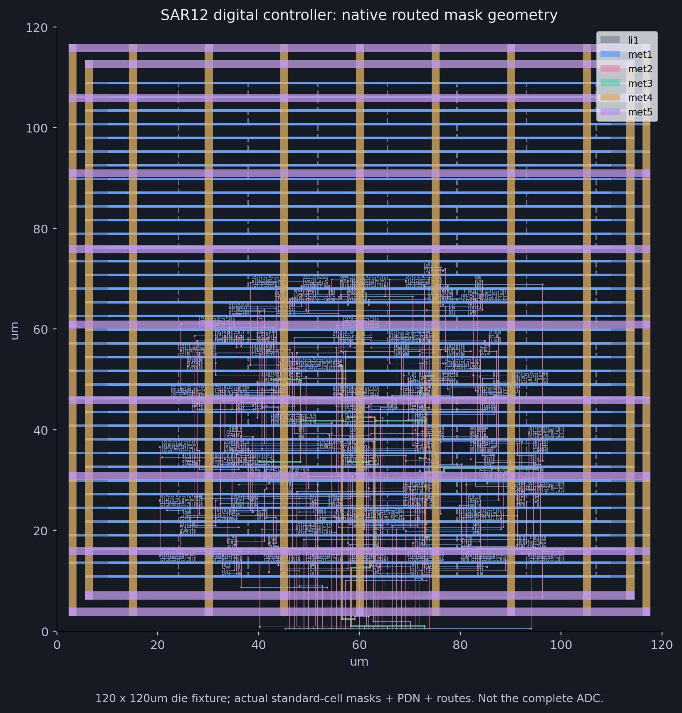
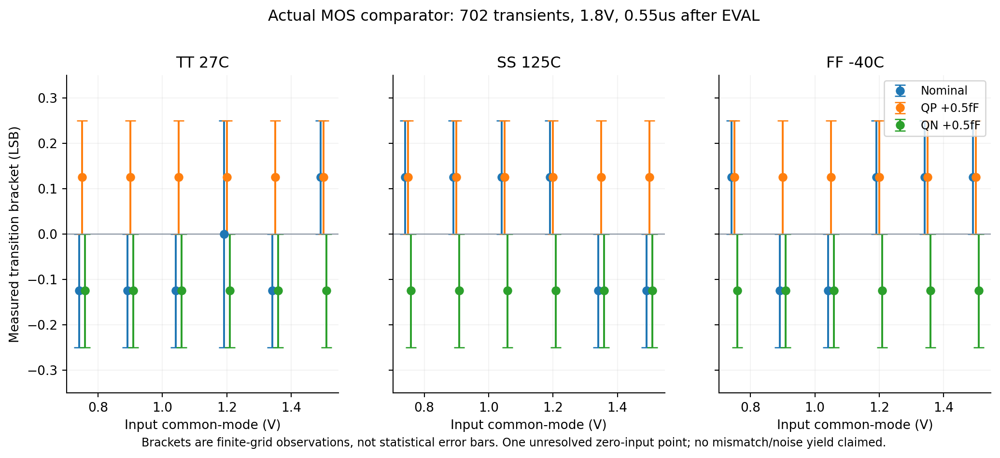

# Resistor Indust · Paper-based SAR12 verification

2026-10-20 · 실제 native 엔진 실행. 제조 signoff 미완료.

[검증 보고서·제약·재현 절차](../../docs/paper-signoff-validation.md) · [원본 결과 ZIP](../Resistor-Paper-SAR12-Verification.zip) · [기계 판독 결과](report.json) · [참조·라이선스](THIRD_PARTY.md)

디지털 제어기의 실제 배치·CTS·상세 배선·전원망·OpenRCX를 만들고 배선 후 3개 cell corner의 setup/hold를 확인했습니다. SS hold 실패를 실제 버퍼 2개로 수정했습니다. GDS mask DRC/LVS, 4,096코드 게이트 검사, 비교기 702회 MOS sweep과 독립 C/RC 행렬 비교를 포함합니다.

아날로그 결합 C 정합성 검사는 **실패**입니다. 이 결과 묶음은 foundry 제조 승인이나 전체 ADC 배선 후 ENOB 통과 증명이 아닙니다.

ZIP에는 아날로그 GDS·PEX/검사 원본, 디지털 GDS/DEF/ODB/Verilog/SPEF, 실제 SDC/SDF/STA log, 수정 전 SS 실패, 702회 testbench/waveform/log, 독립 matrix audit, source/tool/deck hash, 양성·음성 대조군이 들어 있습니다. `.register.zip` 학습 프로젝트와 달리, 이 묶음은 EDA 원본과 검증 근거 모음입니다. 앱에서 GDS를 열어도 과거 검증을 현재 PASS로 상속하지 않습니다.

원본 파형의 time·voltage를 그대로 보존합니다. simulator program, 상용 PDK·license/key, 사용자의 별도 프로젝트는 포함하지 않습니다.
