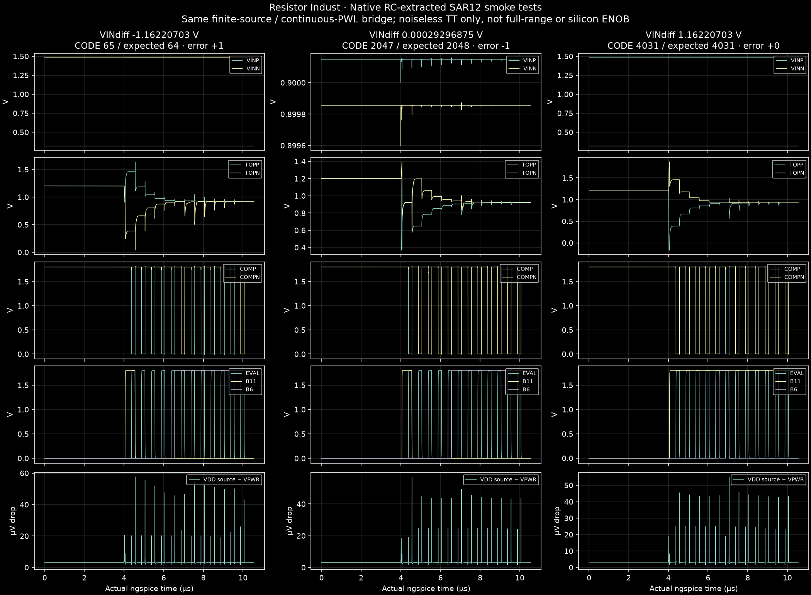

# Resistor Indust · 12-bit SAR ADC lab

> **배선 후 3개 입력 smoke 검사 완료.** 낮은 입력·중앙·높은 입력의 36회 실제 비교기 판단, 원본 정지 시각 및 세 제어기 replay를 확인했습니다. 전체 입력 범위·배선 후 ENOB·제조 승인은 미완료입니다. [수렴 수정과 결과](../../docs/sar12-convergence.md) · [동일 PEX 비교](convergence/comparison.json)

[사용법·계산·논문 반영 범위](../../docs/sar12.md) · [12개 편집 블록](blocks.json) · [실행 근거](qualification.json) · [파일 해시](SHA256SUMS.json)

아날로그 코어 **841.205 × 718.720 µm**를 **1,000 × 1,000 µm, edge 10 µm** 안에 배치했습니다. 508 unit + 2 bridge 차동 6+6 CDAC, 자체 바이어스 2단 preamp·동적 latch, 12-bit RTL/합성 gate/편집 CMOS 제어기입니다. 전체 디지털 제어기 마스크·pad/ESD·제조 signoff는 포함하지 않습니다.

## 열기

- [아날로그 마스크 편집 프로젝트](analog/sar12_analog.register.zip)
- [OASIS](analog/sar12_analog.oas) + [sidecar](analog/sar12_analog.oas.mos.json)
- [원본 GDS gzip](analog/sar12_analog.gds.gz) + [sidecar](analog/sar12_analog.gds.mos.json) — 압축 해제 후 사용. 브라우저 업로드에는 OASIS/bundle을 사용합니다.
- [SPICE](analog/core.spice), [배치·배선·영역 검사](analog/routing-report.json), [교환 형식 round-trip](analog/exchange.json)
- 전체 ADC와 하위 블록은 [hierarchy](hierarchy/)의 각 register.zip으로 가져옵니다. 가져온 프로젝트는 과거 PASS 없이 새 검사로 시작합니다.

## 실행된 검사

| 검사 | 실행 | 분석 | 소스 상태 | 원본 근거 |
|---|---|---|---|---|
| pex-low | completed | pass | current | [f0825476](runs/f08254760b4241cba53c1c5c1f802005/result.json) |
| pre-low | completed | pass | current | [0dfb8c66](runs/0dfb8c66b66d4c06b62ace4735c47bc5/result.json) |
| coherent64 | completed | pass | current | [c6dacddd](runs/c6dacddd4ff440368c824a947e64b768/result.json) |
| post-single | completed | pass | current | [594bb26d](runs/594bb26dadbc4cfa888cf32a36f18d15/result.json) |
| post-code-64 | completed | pass | current | [9f7f0dd5](runs/9f7f0dd5c8c74fa08bcf3317e6eebe59/result.json) |
| post-code-4031 | completed | pass | current | [ca3f51db](runs/ca3f51dbaac34d999e7156cee495d2fd/result.json) |
| directed | completed | pass | current | [52c15cc5](runs/52c15cc5b82243fea4010f2a6954a3cb/result.json) |
| drc | completed | pass | current | [f2b26e9c](runs/f2b26e9cc48d40aea401b9fcd67461c5/result.json) |
| lvs | completed | pass | current | [67e0e5c0](runs/67e0e5c006e94f23aa8ee03fb85380e9/result.json) |
| pex | completed | pass | current | [34b780f3](runs/34b780f3dc694e51a261ffce71bd421d/result.json) |
| imported | completed | pass | current | [86acb80e](runs/86acb80eda584a049167346c3f15d919/result.json) |
| pre-single | completed | pass | current | [aa0e6d12](runs/aa0e6d129ecd4a7da79582f9b670da1f/result.json) |
| ss-smoke | completed | pass | stale | [5ad396ce](runs/5ad396cea0a84e1bbf99d48fa71f18b9/result.json) |
| ff-smoke | completed | pass | stale | [08e16d78](runs/08e16d781e99415e963051e380867f72/result.json) |
| historical-drc-gap | completed | fail | stale | [16d272a0](runs/16d272a0b00a4514913b50c198ce8af9/result.json) |
| historical-post-parser | failed | unknown | stale | [742717a3](runs/742717a3a46149ccbec5f0caae6f0fb8/result.json) |
| historical-post-ideal-source | failed | unknown | stale | [8a098651](runs/8a098651639f4123b3e5251749efa44c/result.json) |
| historical-post-low-dc | failed | unknown | stale | [d52e6edd](runs/d52e6edd331f4f61a400ac2fc30fc73b/result.json) |
| historical-post-high-dc | failed | unknown | stale | [45c3000c](runs/45c3000c7cfc43e099746e1bcbfbdb77/result.json) |
| historical-post-mid-resistive-dc | completed | pass | stale | [2d98972a](runs/2d98972a4a3b4b10984ec1c1790fe1a7/result.json) |
| historical-pre64-relational-stop | failed | unknown | stale | [82178192](runs/82178192368547de8aeb81fbc5cf6b4b/result.json) |
| historical-post-klu-repeat | failed | unknown | stale | [4b5d8c07](runs/4b5d8c07679a4efda589d495092c2fe2/result.json) |

64점 sampled-input coherent sequence: TT 1.8 V/27°C, Fs 99502.488 Hz, SNDR **73.03 dB**, SFDR **81.65 dB**, 무잡음 ENOB **11.84 bit**. 열잡음·편차·지터와 연속 정현파 track/hold 성능은 제외합니다. 배선 후 ENOB나 실물 12-bit 정확도는 입증하지 않았습니다. SS/FF는 한 입력의 smoke 검사이며 전체 corner 정확도 검사가 아닙니다.

[제어기 검사](controller/evidence.json)는 세 구현에서 각각 4,096개 oracle 코드·159,751개 assertion을 통과한 디지털 논리 검사입니다. 4,096 MOS ADC 변환을 측정한 결과가 아닙니다. [C-only/R+C 비교](coupling/comparison.json)는 실제 독립 추출 결과이며 아직 bit별 전기적 매칭·결합 추출 완전성을 승인하지 않습니다.

실패한 post-layout 실행과 과거 DRC 오류도 표에 남깁니다. 수렴·시각 검사 실패는 PASS로 바꾸지 않습니다. 큰 원본 raw trace는 isolated workspace에 보존하며 각 실행의 raw-trace.json에 바이트 수·SHA-256을 기록합니다. 표시용 waveforms.json.gz는 실제 시간축의 선택 샘플입니다. 원본 입력 자극·12회 결정 전체·netlist·로그·manifest로 검사를 재현할 수 있습니다. 공개 SKY130 모델과 도구는 별도 설치가 필요합니다.
