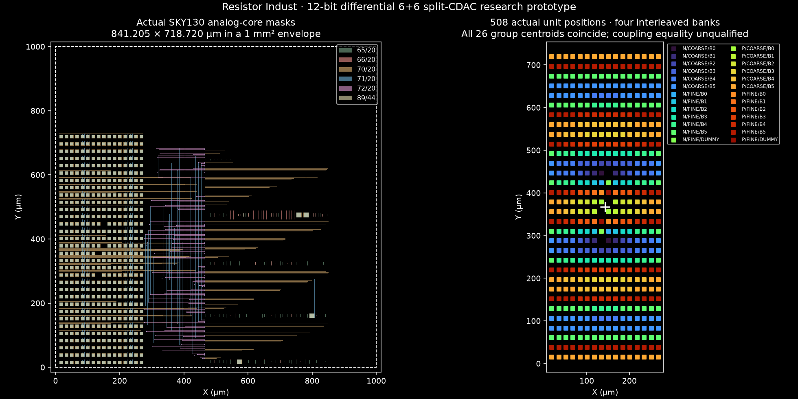
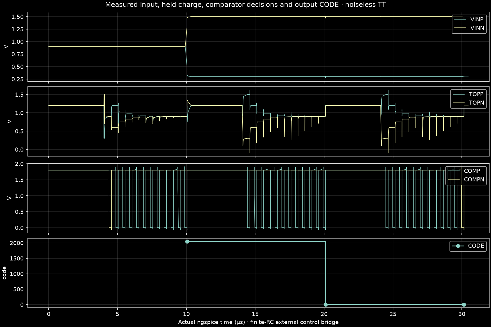
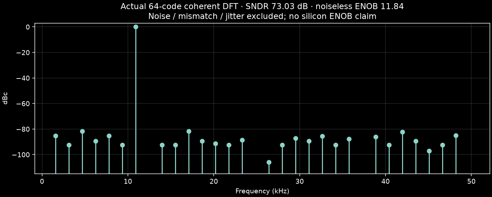

# Resistor Indust · 12-bit SAR ADC lab

> **연구용 레퍼런스 · 배선 후 검증 미달.** Post-layout failed / unknown: ngspice exited with code 1. Raw log retained. DRC/LVS/PEX 생성과 배선 전 파형 통과는 제조용 전기적 승인을 뜻하지 않습니다.

[사용법·계산·논문 반영 범위](../../docs/sar12.md) · [12개 편집 블록](blocks.json) · [실행 근거](qualification.json) · [파일 해시](SHA256SUMS.json)

아날로그 코어 **841.205 × 718.720 µm**를 **1,000 × 1,000 µm, edge 10 µm** 안에 배치했습니다. 508 unit + 2 bridge 차동 6+6 CDAC, 자체 바이어스 2단 preamp·동적 latch, 12-bit RTL/합성 gate/편집 CMOS 제어기입니다. 전체 디지털 제어기 마스크·pad/ESD·제조 signoff는 포함하지 않습니다.

## 열기

- [아날로그 마스크 편집 프로젝트](analog/sar12_analog.register.zip)
- [OASIS](analog/sar12_analog.oas) + [sidecar](analog/sar12_analog.oas.mos.json)
- [원본 GDS gzip](analog/sar12_analog.gds.gz) + [sidecar](analog/sar12_analog.gds.mos.json) — 압축 해제 후 사용. 브라우저 업로드에는 OASIS/bundle을 사용합니다.
- [SPICE](analog/core.spice), [배치·배선·영역 검사](analog/routing-report.json), [교환 형식 round-trip](analog/exchange.json)
- 전체 ADC와 하위 블록은 [hierarchy](hierarchy/)의 각 register.zip으로 가져옵니다. 가져온 프로젝트는 과거 PASS 없이 새 검사로 시작합니다.

## 실행된 검사

| 검사 | 실행 | 분석 | 소스 상태 | 원본 근거 |
|---|---|---|---|---|
| drc | completed | pass | current | [c384b1bd](runs/c384b1bd3b784686b070b1b862f3dc4b/result.json) |
| lvs | completed | pass | current | [ffebf48e](runs/ffebf48e94944fc0bf02fd465fc95470/result.json) |
| pex | completed | pass | current | [77207131](runs/7720713187ea404db3d2e224720f396c/result.json) |
| directed | completed | pass | current | [d2937073](runs/d2937073af124a519ebaa3fb05b03260/result.json) |
| coherent64 | completed | pass | current | [287ded48](runs/287ded48f737402c90b4ad194d94824b/result.json) |
| imported | completed | pass | current | [1de63a53](runs/1de63a5347d64a649dea184614ee383a/result.json) |
| ss-smoke | completed | pass | current | [5ad396ce](runs/5ad396cea0a84e1bbf99d48fa71f18b9/result.json) |
| ff-smoke | completed | pass | current | [08e16d78](runs/08e16d781e99415e963051e380867f72/result.json) |
| post-single | failed | unknown | current | [8a098651](runs/8a098651639f4123b3e5251749efa44c/result.json) |
| historical-drc-gap | completed | fail | stale | [16d272a0](runs/16d272a0b00a4514913b50c198ce8af9/result.json) |
| historical-post-parser | failed | unknown | stale | [742717a3](runs/742717a3a46149ccbec5f0caae6f0fb8/result.json) |

64점 sampled-input coherent sequence: TT 1.8 V/27°C, Fs 99502.488 Hz, SNDR **73.03 dB**, SFDR **81.65 dB**, 무잡음 ENOB **11.84 bit**. 열잡음·편차·지터와 연속 정현파 track/hold 성능은 제외합니다. 배선 후 ENOB나 실물 12-bit 정확도는 입증하지 않았습니다. SS/FF는 한 입력의 smoke 검사이며 전체 corner 정확도 검사가 아닙니다.

[제어기 검사](controller/evidence.json)는 세 구현에서 각각 4,096개 oracle 코드·159,751개 assertion을 통과한 디지털 논리 검사입니다. 4,096 MOS ADC 변환을 측정한 결과가 아닙니다. [C-only/R+C 비교](coupling/comparison.json)는 실제 독립 추출 결과이며 아직 bit별 전기적 매칭·결합 추출 완전성을 승인하지 않습니다.

실패한 post-layout 실행과 과거 DRC 오류도 표에 남깁니다. 수렴·시각 검사 실패는 PASS로 바꾸지 않습니다. 큰 원본 raw trace는 isolated workspace에 보존하며 각 실행의 raw-trace.json에 바이트 수·SHA-256을 기록합니다. 표시용 waveforms.json.gz는 실제 시간축의 선택 샘플입니다. 원본 입력 자극·12회 결정 전체·netlist·로그·manifest로 검사를 재현할 수 있습니다. 공개 SKY130 모델과 도구는 별도 설치가 필요합니다.
